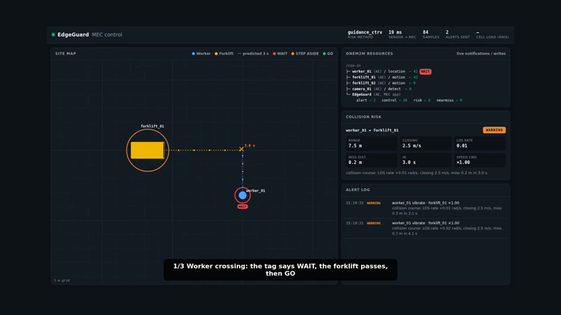
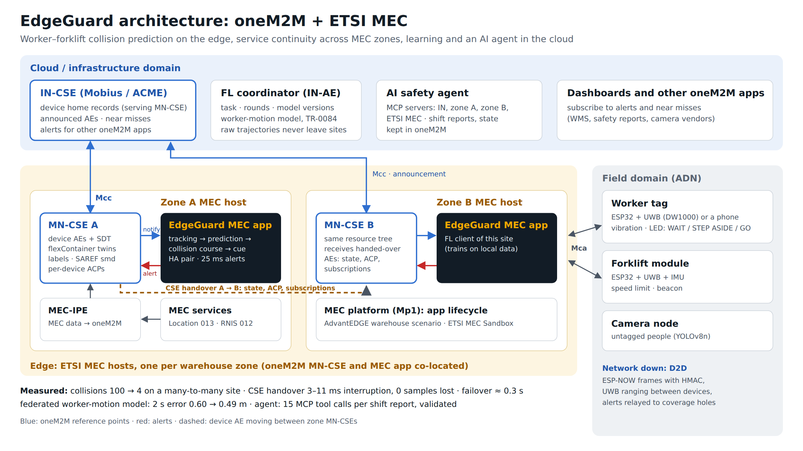
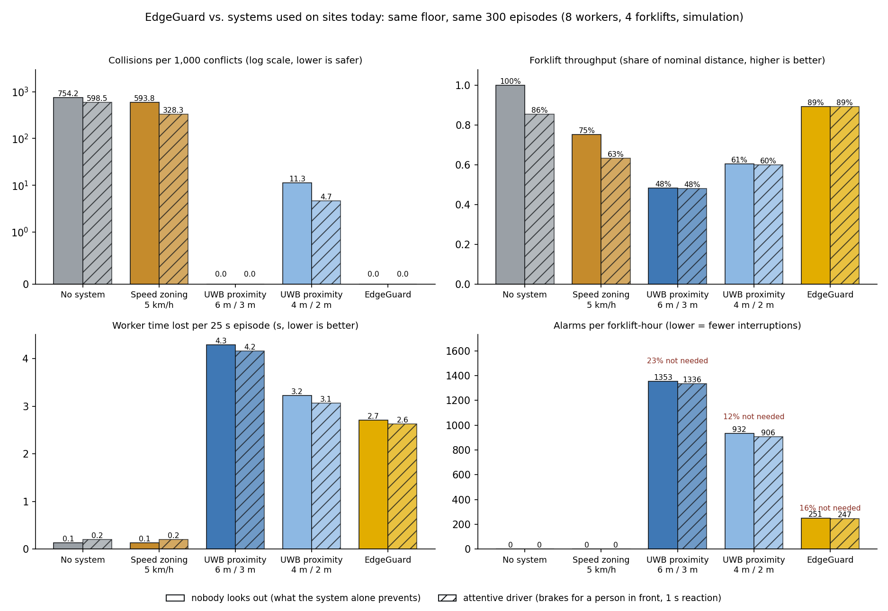

# EdgeGuard

[](https://github.com/ljw22112/Edgeguard/actions/workflows/ci.yml)

[English](README.md) | **한국어** · **[심사위원용 웹](https://ljw22112.github.io/Edgeguard/)** · [변경 기록](CHANGELOG.md) · [기여 안내](CONTRIBUTING.md) · [보안](SECURITY.md)

**MEC 기반 작업자–지게차 충돌 예측 AIoT 안전 서비스**
2026 oneM2M International Hackathon · Team EdgeGuard (세종대학교)

작업자 태그와 지게차 센서 데이터를 **oneM2M**으로 모으고, **ETSI MEC** 엣지에서 충돌을 1~3초 전에 예측합니다.
위험하면 작업자 태그는 **기다려(WAIT) → 지나갔다(GO)** 를 알리고 지게차는 필요한 만큼만 감속합니다.
망이나 서버가 끊겨도 단말끼리 직접 통신(D2D)해서 판단을 이어 갑니다.

## 한눈에

| | v1.0 (진동 경보) | **현재 (v1.5)** |
|---|---|---|
| 다대다 현장 충돌 (작업자 8 · 지게차 4, 위험 750쌍) | 100건 | **4건 (−96 %)** |
| 지게차 처리량 (다대다) | 61.7 % | **86.0 %** |
| 1:1 조우 충돌 (위험 1,207회) | 145건 | **1건** |
| 통신 음영 속 충돌 (작업자 / 지게차, 180회) | 16 / 19건 | **0 / 0건** |

> 수치는 시뮬레이션 결과입니다. 단말 동작은 **보드용 펌웨어를 그대로 PC에서 돌려** 실제 oneM2M CSE와 매 커밋 시험하고(CI 6/6), 휴대폰을 작업자 태그로 씁니다([실물 시연](docs/ko/hardware-demo.md)).
> **기사: [hackster.io](https://www.hackster.io/ahind012/edgeguard-stop-forklift-accidents-before-they-happen-e07309)** · **최종 영상: [YouTube](https://youtu.be/P2JI5ZG6PIg)** (2분 34초) · 데모 영상: **`results/edgeguard_final.mp4`** (최종, 2분 34초, 자막 · [스토리보드](docs/video-script.md)) · `results/edgeguard_demo_v1.3.mp4` (라이브 데모 3장면, 약 1분 50초) · `results/edgeguard_firmware_in_the_loop.mp4` (펌웨어 + 휴대폰 태그, 약 30초).



## 동작 방식



```
 작업자 태그 · 지게차 모듈 (ESP32 + UWB)
        │ 위치 · 속도 (oneM2M CIN)                 ▲ WAIT / GO / STEP ASIDE · 속도 제한
        ▼                                         │
   oneM2M CSE (Mobius) ── Notify ──▶ MEC 앱: 추적 → 경로 예측 → 충돌 코스 판정 → 경보
        ▲                                ▲
        │ (망 · 서버 장애 시)              └─ ETSI MEC Location / RNIS API
 단말끼리 D2D: 상태 교환 · 로컬 판단 · 경보 중계
```

1. **감지** — UWB 측위(작업자 태그 · 지게차), 선택적으로 카메라와 MEC Location API.
2. **예측** — 칼만 추적 + 지게차 회전 예측(CTRV), 지게차 계획 경로를 공유받으면 그 경로로 예측.
3. **판정** — 거리 대신 **충돌 코스**(시선각 변화율 · 최근접점)로 판단해 지나쳐 가는 경우엔 울리지 않습니다.
4. **경보** — 작업자: WAIT(대기 유지) → GO / 길 위에 서 있으면 STEP ASIDE(가장자리로 비켜서기).
   지게차: 부딪히지 않을 만큼만 감속. 대치 상황은 한쪽씩 먼저 보내 동시 출발 충돌을 막습니다.
5. **장애 시** — MEC 예측 → 단말 간 UWB 거리 · D2D 상태 교환 → 정지 순으로 단계적 강등, 음영 단말에는 이웃이 경보를 중계.

## EdgeGuard의 oneM2M

**왜 oneM2M인가.** 자체 서버가 해야 할 일을 CSE가 대신합니다.

- **데이터베이스가 아닌 허브** — 단말과 앱은 직접 통신하지 않습니다. 구독이 위치를 MEC 앱으로, 경보를 태그로 보내므로 브로커 · 폴링 코드가 없습니다.
- **다른 앱에 열려 있음** — 경보 · 아차사고가 표준 리소스라 WMS · 리포트 도구 · 카메라 업체가 연동 작업 없이 구독할 수 있습니다.
- **접근제어 내장** — 디바이스 AE마다 ACP로 최소 권한. CI가 매 커밋 Mobius에서 다른 단말의 위조 쓰기 차단을 확인합니다(8/8).
- **벤더 중립, 엣지에서 클라우드까지** — 같은 코드가 KETI Mobius 3.0.1 · ACME에서 동작, 엣지 MN-CSE가 클라우드 IN-CSE에 Mcc로 등록. 상호운용성 문제 7건 정리.

| oneM2M 기능 | 용도 | 상태 |
|---|---|---|
| AE · container · contentInstance | 디바이스별 데이터(originator = 디바이스), MEC 앱 판단 결과 | 사용 중 |
| subscription / notify | 위치 → MEC 앱, 경보 → 태그 · 대시보드 | 사용 중 |
| accessControlPolicy | 디바이스 AE마다 ACP, 최소 권한 ([리소스 트리](docs/ko/deployment.md#onem2m-리소스-트리)) | 사용 중 |
| maxNrOfInstances | 이력 상한(아차사고 2,000, 이중화 리스 20) | 사용 중 |
| Mcc 등록 | 엣지 MN-CSE ↔ 클라우드 IN-CSE | 사용 중 |
| flexContainer(SDT, TS-0023 방식) + 라벨 + 탐색 | 자체 SDT 도메인 `org.edgeguard.safety` + 표준 `cod:bat`로 만든 디바이스 트윈, 라벨로 단말 자동 등록(단말 목록 불필요) ([데이터 모델](docs/ko/data-model.md)) | 사용 중 |
| semanticDescriptor(SAREF) + 시맨틱 쿼리 | "A 구역에서 구동 속도를 제어하는 지게차" → oneM2M 경로 | 사용 중 |
| accessControlObjectDetails(chty) | MEC 앱은 디바이스 트윈에 구독만 만들 수 있음 | 사용 중 |
| announcement · CSE 핸드오버 | 디바이스 AE가 상태 · ACP · 구독과 함께 구역 MN-CSE 사이를 이동, IN-CSE에 AEAnnc ([핸드오버](docs/ko/handover.md)) | 사용 중 |
| group(fanOutPoint) · pollingChannel | 구역 내 모든 태그에 DANGER 경보 1회, NAT 뒤 태그는 폴링 채널로 수신 ([구역 방송](docs/ko/transport-security.md)) · 스웜 컨텍스트를 요청 한 번으로 읽기 | 사용 중 |
| MQTT 바인딩 · TLS | 단말은 MQTT over TLS(비밀번호 + 발신자별 브로커 ACL), CSE와 앱은 HTTPS ([보안 전송](docs/ko/transport-security.md)) | 사용 중 |

**ETSI MEC.** MEC-IPE가 MEC 013 Location · MEC 012 RNIS를 CSE에 넣어 MEC 앱이 oneM2M을 통해 MEC 서비스를 씁니다. 이벤트 기반 IPE는 MEC 구역 이벤트와 단말별 신호 세기도 oneM2M 리소스(MEC 데이터용 SDT 클래스)로 바꿉니다. oneM2M 앱이 MEC 서비스를 요청할 수 있고, 구역 이벤트가 CSE 핸드오버를 트리거합니다([모빌리티](docs/ko/mobility.md)). 플랫폼 쪽으로는 **MEC 011 Mp1**(서비스 등록 · 탐색), **MEC 021 AMS**(컨텍스트 전송을 동반한 앱 이동을 핸드오버 트리거로), **MEC 013 영역 · 거리** 구독을 씁니다([MEC 플랫폼](docs/ko/mec-platform.md)). EdgeGuard는 ESTIMED 배포 옵션 C를 따라, 구역마다 MEC 호스트 하나에 MN-CSE · MEC 앱 · IPE를 함께 둡니다([TR-0077 7절 매핑](docs/ko/estimed-mapping.md)). 공개 ETSI MEC Sandbox(try-mec.etsi.org) 실연동, 자체 설치 AdvantEDGE 창고 시나리오에서 경보 70건.

**oneM2M이 처음이라면:** [튜토리얼: 10분 만에 만드는 oneM2M 안전 앱](docs/ko/tutorial-onem2m.md), HTTP 요청만 사용, CI에서 실행.

**더 알아보기:** [oneM2M](https://www.onem2m.org) · [oneM2M 표준 문서](https://www.onem2m.org/technical/published-specifications) (TS-0001 구조, TS-0004 프로토콜) · [ACME CSE](https://github.com/ankraft/ACME-oneM2M-CSE) · [KETI Mobius](https://github.com/IoTKETI/Mobius) · [ETSI MEC](https://www.etsi.org/technologies/multi-access-edge-computing)

## 엣지 너머: ESTIMED / TR-0077 7절

| | 내용 | 측정 (CI, 매 커밋) |
|---|---|---|
| [CSE 핸드오버](docs/ko/handover.md) | 지게차의 oneM2M 존재가 구역 MN-CSE 사이를 따라 이동(make-before-break), 구역 CSE 고장 시 자동 전환 | 위치 기반: 서비스 중단 **3~11 ms**, 유실 **0** · 고장 전환 약 0.3초 |
| [연합학습](docs/ko/federated-learning.md) | 사이트마다 자기 데이터로 작업자 이동 모델 학습, 작업 · 참여자 · 라운드 · 모델 버전이 oneM2M 리소스(TR-0084) | 2초 예측 오차 0.604 → **0.486 m**, 이탈 · 늦은 참여 처리 |
| [AI 안전 에이전트](docs/ko/ai-agent.md) | IN-CSE · 두 구역 MN-CSE · ETSI MEC의 MCP 서버로 교대 안전 리포트, 상태는 oneM2M에 저장 | 도구 호출 15회 · 검증 통과, 구역 고장 시 부분 리포트 |
| [데이터 모델](docs/ko/data-model.md) | SDT flexContainer 트윈, 라벨, SAREF 시맨틱 | 스스로 등록한 단말 약 9초 만에 자동 편입(CI 실행) |
| [MEC 플랫폼 API](docs/ko/mec-platform.md) (7.1, 7.2) | oneM2M 위치를 담은 Mp1 서비스 등록 · 탐색, AMS 이동 시 앱 컨텍스트와 oneM2M 트윈이 함께 이동, 네트워크가 계산하는 지오펜스 · 작업자-지게차 거리 | 10/10: AMS A → B → A, 컨텍스트 약 2~20 ms, 지오펜스 · 거리 이벤트 → oneM2M 약 10 ms |
| [MEC 모빌리티](docs/ko/mobility.md) (7.1, 7.2) | MEC 구역 이벤트 · RNIS 신호 세기를 oneM2M으로, oneM2M 앱의 MEC 요청, MEC 네트워크가 트리거하는 핸드오버 | 구역 이벤트로 A → B → A: 중단 **1.5~8 ms**, 유실 **0**, 이벤트 → oneM2M 15~45 ms |
| [앱 오케스트레이션](docs/ko/orchestration.md) (7.1) | 의도 리소스 하나 → MEC 호스트 간 탐색 · 선택 · 배포 · 등록 · 프로비저닝, 인스턴스마다 컨테이너, 호스트 장애 시 재배치 | 호스트 장애 → 새 컨테이너로 약 2~3초 만에 재실행 |
| [모델 전달](docs/ko/swarm-and-model-delivery.md) (7.3) | 카나리 → 위험 엔진에서 활성화 → 섀도 감시 → 롤백 | 미학습 · 손상 버전 거부, 성능 저하 시 롤백 |
| [스웜](docs/ko/swarm-and-model-delivery.md) (7.4) | 지게차가 그룹으로 계획을 공유하고 각자 같은 충돌 없는 일정 계산 | 충돌 → 0, 총 지연 14.5초 vs 대응 방식 23.5초 |
| [구역 방송 · 보안 전송](docs/ko/transport-security.md) | NAT 뒤 태그로 그룹 팬아웃, 펌웨어까지 MQTT/TLS · 단말별 인증서(상호 TLS, CRL), HTTPS 앱 | 요청 1회로 태그 3개, p50 8~19 ms, 원본 펌웨어가 HTTP · MQTT · 상호 TLS 모두 통과, 폐기 · 다른 CA · 인증서 없음 거부 |

## 핵심 결과

### 현장에서 쓰는 방식과 비교 ([자세히](docs/ko/site-compare.md))

모든 방식을 같은 시뮬레이션 현장, 같은 시험 에피소드 300개로 돌렸습니다(작업자 8명 · 지게차 4대, 충돌 상황 1,066건, 아무도 주의하지 않는 조건). 시험 에피소드는 EdgeGuard 정책의 학습 · 선택에 쓰지 않았습니다.

| | 충돌 | 지게차 처리량 | 지게차 1시간당 경보 |
|---|---|---|---|
| 시스템 없음 | 804 | 100 % | 0 |
| 구역 속도 제한 5 km/h | 633 | 75 % | 0 |
| UWB 근접 경보 6 m / 3 m | 0 | 48 % | 1,353 |
| UWB 근접 경보 4 m / 2 m | 12 | 61 % | 932 |
| EdgeGuard 이전 정책 | 1 | 91 % | 233 |
| **EdgeGuard (강건 정책)** | **0** | **97 %** | **249** |

넓은 근접 경보만큼 안전하면서 처리량 2.0배, 경보 −82 %. 좁힌 근접 경보 대비 충돌 12건 → 0건, 처리량 +60 %. 작업자가 양보하고 지게차는 **정지 지점**에 맞춰 스스로 제동합니다. 통신 불량 · MEC 재시작 · 낮은 준수율 · 측위 오차 · 혼잡에서도 시험 1,200 에피소드 중 충돌 1건(이전 정책 3건), 모든 조건에서 처리량 5~9%p 향상([강건성](docs/ko/robustness.md)).



### 고장 상황에서 서버 안정성 ([자세히](docs/ko/stability.md))

CI의 장기 실행 시험(알림 2,000건 폭주, 카메라 변동, 10초 단절, CSE 상태 유실)에서, CSE가 상태를 잃으면 MEC 앱이 다시는 경보를 보내지 못하는 문제를 찾았습니다. 수정 후: 경보 복구 **2.1초**, 장치 데이터 복구 2.1초(수정 전 11.1초), 가장 느린 `/health` 112 ms(수정 전 358 ms), 검사 14/14(수정 전 10/14).

### 안전

| 항목 | 결과 | 비교 |
|---|---|---|
| 적시 감지 (접촉 1초 전) | **100 %**, 리드타임 중앙값 2.4 s | 근접 5 m 경보 76 % |
| 오경보율 | **30 %** | 근접 5 m 경보 85 % |
| 오경보 추가 감소 (v1.2) | 622 → 570 → **400** / 993 (정지 판정 → 경로 공유) | — |
| 사각 코너 (현장 지도) | 충돌 17 → **11** / 80 | 지도 없음 |
| 작업자 WAIT 준수율 85 / 70 / 50 % | 충돌 12 / 27 / 42 / 1,207 | v1.0 145 |

### 작업 속도

| 항목 | 결과 | 비교 |
|---|---|---|
| 지게차 처리량 (다대다) | **86.0 %**, 대당 손실 11.2 → 5.7 s | v1.0 61.7 % |
| 지게차 처리량 (1:1) | **86.4 %** (경로 공유 시 89.0 %) | v1.0 77.3 % |
| 작업자 손실 / 조우 | 1:1 2.07 → 3.16 s, 다대다 2.5 → 2.7 s | 대기 신호의 비용 |

### 장애 · 신뢰성

| 항목 | 결과 | 비교 |
|---|---|---|
| 망 완전 단절 | 충돌 180 → **2**, 처리량 57 % | 전부 정지 방식 18 % |
| MEC 앱 8초 다운 | 충돌 85 → **11** / 180 | v0.7 |
| MEC 앱 장애 인수 (이중화) | **0.73 s**, 하트비트 공백 1.0 s | 지게차 로컬 전환 기준 2 s |
| 경보 지연 중앙값 | **25 ms** (엣지), 팀 노트북 58 ms | 클라우드 전용 85 ms · 단절 시 0건 |
| 규모 (단말 40대) | 경보 지연 p95 1,642 → **256 ms** | 고정 보고 주기 |

### 비용 · 사업성

| 항목 | 내용 |
|---|---|
| 시장 | 지게차 충돌 방지 시스템 세계 시장 11.8억 달러(2024) → 51.1억 달러(2034), 연 10.9 % |
| 도입 비용 (창고 1만 m² · 작업자 50 · 지게차 10) | 초기 약 2,100만 원 (저가 ESP32 + UWB 단말, 엣지 서버 이중화) |
| 투자 회수 | 지게차 시간 절감만으로 1.3~4년, 부상 1건 예방(약 1.6억 원)이면 즉시 |
| 사업 모델 | 하드웨어 키트 + 구독형 소프트웨어(지게차 월 3만 원 · 작업자 월 5천 원) + 통신사 MEC 제휴 |

자세한 내용: [비용 · 시장 · 사업 모델](docs/ko/business.md)

## 차별점

| | 기존 방식 | EdgeGuard |
|---|---|---|
| 판정 | 거리 기준 → 잦은 오경보 · 경보 피로 | **충돌 코스** 기준 (미사일 유도의 LOS rate · CPA) |
| 사람에게 주는 신호 | 진동 한 번 → 잠깐 섰다가 다시 걸음 | **WAIT → GO**, 길 위면 **STEP ASIDE** |
| 지게차 제어 | 멈추거나 저속 고정 | 부딪히지 않을 만큼만 감속, 대치는 한쪽씩 해소 |
| 망 장애 | 서버가 죽으면 경보도 없음 | **단계적 강등 + D2D** (터널 속 자율주행차처럼) |
| 다대다 | 쌍별 계획을 따로 관리하지 않음 | 지게차는 작업자별, 태그는 지게차별로 관리 |
| 표준 | 독자 프로토콜 · 독자 서버 | 디바이스별 oneM2M AE + ETSI MEC API — 다른 oneM2M 앱이 경보 · 아차사고를 바로 구독 |
| 운영 | — | 이중화 · 모니터링 · 아차사고 히트맵 · D2D 인증 |

## 빠른 시작

```bash
cd deploy
docker compose --profile demo up -d                     # Mobius + MEC 앱 + 가상 디바이스 (조우 4회)
python3 check_demo.py out/devices.json http://localhost:9090/health
# 대시보드: http://localhost:9090/  (작업자별 WAIT / STEP ASIDE / GO 표시)

MEC_HA=1 docker compose --profile ha up -d              # + 대기 MEC 앱 (이중화)
# 반응하는 라이브 데모 (로컬 ACME): scripts/run_live_demo.sh   · 실물 보드와 함께: HW=1 scripts/run_live_demo.sh
docker compose --profile monitoring up -d               # + Prometheus :9095 · Grafana :3000
```

| 하고 싶은 것 | 명령 |
|---|---|
| Docker 없이 로컬 데모 | `pip install -r requirements.txt && scripts/run_local_demo.sh crossing_conflict` |
| 테스트 | `python -m pytest` |
| EdgeGuard SDT 도메인을 설치한 ACME CSE | `scripts/acme.sh start in mn-a mn-b` (IN-CSE :8080, 구역 MN-CSE :8081 / :8082) |
| 데이터 모델 점검(트윈 · 라벨 · SAREF · 자동 등록) | `python deploy/check_sdt.py --onboard` (라이브 데모 실행 중) |
| 구역 간 CSE 핸드오버 | `python tools/handover_demo.py [--failover]` |
| oneM2M 기반 연합학습 | `python tools/fl_demo.py` |
| MCP 기반 AI 안전 에이전트 | `python tools/agent_demo.py` · `python -m agent.safety_agent report` |
| 반응하는 라이브 데모 / 데모 영상 녹화 | `scripts/run_live_demo.sh` / `scripts/run_live_demo.sh record` |
| 펌웨어 그대로 실행 (SIL, CI와 동일) | `python tools/sil_run.py` · `--scene head_on` |
| 휴대폰을 작업자 태그로 | MEC 앱 실행 중 휴대폰에서 `http://<주소>:9090/tag?worker=worker_01` |
| 실물 보드 시연 (ESP32 2개) | [실물 시연 가이드](docs/ko/hardware-demo.md) |
| 사용자 검증 실험 (휴대폰 태그) | `python tools/user_study.py` → [사용자 검증](docs/ko/user-study.md) |
| 다대다 시뮬레이션 | `python -m sim.multi_sim` |
| 1:1 · 준수율 평가 | `python -m sim.worker_cue_eval` |
| 오경보 평가 | `python -m sim.false_alarm_eval` |
| 장애 조건 평가 | `python -m sim.failsafe_eval --modes coop` |

## 구성

| 영역 | 내용 |
|---|---|
| 위험도 엔진 | 칼만 추적, CV · CTRV · 경로 · LSTM 예측, 충돌 코스 판정(CPA/TCPA · LOS rate · collision cone · VO 감속량), 학습된 경보 정책 |
| 경보 정책 | WAIT 유지 신호, GO 안전 확인, 대치 해소(한쪽씩 먼저), STEP ASIDE, 사각 코너 보정 |
| MEC 앱 | FastAPI: 알림 수신 → risk / alert / control 게시, 우선순위 송신 큐, 대시보드, `/health` · `/metrics` · `/nearmiss` |
| 단말 펌웨어 | ESP32 + DW1000 (작업자 태그 · 지게차 모듈): UWB 측위, WAIT/GO 신호, 쌍별 속도 계획, 로컬 규칙, ESP-NOW D2D + HMAC |
| 연동 | oneM2M Mobius / ACME, ETSI MEC Location · RNIS (MEC-IPE), 클라우드 사본 동기화, 카메라(YOLOv8n) 노드 |
| 배포 · CI | Docker Compose (demo · ha · monitoring · sandbox), GitHub Actions: 테스트 → 펌웨어 그대로 실행(SIL) → 스택 종단 · 재시작 · 장애 인수 · 모니터링 시험 → GHCR |

## 문서

| 문서 | 내용 |
|---|---|
| [위험도 엔진과 성능 평가](docs/ko/risk-and-evaluation.md) | v1.2 다대다 · 대치 해소 · 비켜서기 · 오경보, v1.1 WAIT/GO, 충돌 코스 판정, 비교 실험, LSTM, 정책 학습 |
| [신뢰성](docs/ko/resilience.md) | 단계적 강등(v0.8), D2D 협력(v0.9), 이중화(v1.0), 규모 · 재시작 · 서버 안정화 |
| [현장 방식 비교](docs/ko/site-compare.md) · [강건성](docs/ko/robustness.md) | 구역 속도 제한 · UWB 근접 경보와 비교, 일반 · 예외 시나리오 8종, 지게차 우선 · 정지 지점 · 긴급제동 |
| [현장 기능](docs/ko/site-features.md) | 사각 코너, D2D 인증, 모니터링, 아차사고 분석, 카메라, 접근제어, 대시보드 · 리포트 |
| [배포](docs/ko/deployment.md) | Compose 스택, 로컬 데모, 배포 구조 결정(측정), oneM2M 리소스 트리, 펌웨어 · CI |
| [ETSI MEC 연동 · Sandbox](docs/ko/mec-sandbox.md) | MEC API 연동, 공개 Sandbox 실연동, 자체 설치 Sandbox ([설치 절차](deploy/sandbox-host/README.ko.md)) |
| [비용 · 시장 · 사업 모델](docs/ko/business.md) | 문제 규모, 시장, 도입 비용, 투자 회수, 수익 모델, 확장성, oneM2M 생태계 기여 |
| [도입 장벽과 대응](docs/ko/adoption.md) | 유사 시스템이 현장에 퍼지지 못한 이유와 대응 |
| [상호운용성 노트](docs/ko/interop-notes.md) | CSE 간 시험에서 찾은 문제와 해결 |
| [데이터 모델](docs/ko/data-model.md) | SDT flexContainer 트윈, 라벨 · 탐색, SAREF 시맨틱 디스크립터, ACP |
| [CSE 핸드오버](docs/ko/handover.md) | 구역 MN-CSE, make-before-break 핸드오버, 고장 전환, 이동 가능한 구독, 측정 |
| [연합학습](docs/ko/federated-learning.md) | TR-0084 역할을 oneM2M 리소스로, 참여자 선택 · 이탈 · 늦은 참여, 결과 |
| [AI 안전 에이전트](docs/ko/ai-agent.md) | MCP 서버(CSE별 oneM2M, ETSI MEC), 교대 리포트 워크플로, 라우팅, 상태 저장 |
| [ESTIMED / TR-0077 매핑](docs/ko/estimed-mapping.md) | 배포 연속체(옵션 C), 7.1~7.4절 → EdgeGuard 기능 · 데모, 대체물 |
| [MEC 플랫폼 API](docs/ko/mec-platform.md) | MEC 011 Mp1, MEC 021 AMS 핸드오버 트리거, MEC 013 영역 · 거리 구독 |
| [MEC 모빌리티](docs/ko/mobility.md) | 이벤트 기반 양방향 MEC-IPE, MEC SDT 클래스, 네트워크 트리거 핸드오버, 모빌리티 지도 |
| [앱 오케스트레이션](docs/ko/orchestration.md) | 호스트 등록, 배포 의도, 수명주기, 프로비저닝, 재배치 |
| [스웜과 모델 전달](docs/ko/swarm-and-model-delivery.md) | 그룹 기반 스웜 조정, 연합 모델의 카나리 · 활성화 · 감시 · 롤백 |
| [구역 방송 · 보안 전송](docs/ko/transport-security.md) | 그룹 팬아웃, pollingChannel, MQTT 바인딩 over TLS, HTTPS, 브로커 ACL |
| [hackster.io 기사 (영문)](https://www.hackster.io/ahind012/edgeguard-stop-forklift-accidents-before-they-happen-e07309) ([원고](docs/hackster-article.md)) | hackster.io에 게시한 프로젝트 이야기 |
| [실물 시연](docs/ko/hardware-demo.md) | 펌웨어 그대로 실행(SIL, CI) · 휴대폰 태그 · ESP32 보드(준비물 · 배선 · 체크리스트) |
| [사용자 검증](docs/ko/user-study.md) | 휴대폰 태그로 신호 반응 실험, 안전관리자 인터뷰, 결과를 시뮬레이션에 반영 |
| [인터뷰 예상 질문](docs/interview-qa.md) | 예상 질문 16개와 답변 · 근거 (영문) |
| [공개 · 게시 체크리스트](docs/publish-checklist.md) | 저장소 공개, 영상 업로드, hackster 기사 게시, ACME 이슈 · 포럼 글 초안 |
| [대회 채점표 자체 평가](docs/SCORECARD.md) | 평가 항목별 현재 점수 · 근거 · 점수를 올릴 작업 (업데이트마다 갱신) |

## 폴더

```
edgeguard/   위험도 엔진 · 추적 · 예측 · 경보 정책 · 작업자 신호 · 기기 규칙 · 사이트 지도 · 아차사고 · 이중화 · oneM2M/MEC 클라이언트
mec_app/     MEC 앱 (FastAPI) + 대시보드 + Dockerfile
firmware/    ESP32 스케치 (worker_tag, forklift_module) + 공용 헤더 (UWB 측위, 기기 규칙, WAIT/GO, D2D, HMAC)
deploy/      Docker Compose 스택, 모니터링 설정, Sandbox 호스트 설치 스크립트, 종단 시험 스크립트
sim/         시나리오 · 1:1 / 다대다 폐루프 시뮬레이션 · 장애 · 오경보 평가 · 정책/LSTM 학습
tools/       리소스 셋업 · MEC-IPE · Sandbox 연동/점검 · 부하/구성 시험 · 안전 리포트
results/     평가 결과 (JSON · 그림) · devices/ mec_mock/ scenarios/ models/ scripts/ tests/ docs/
```

## 버전 이력

| 버전 | 핵심 |
|---|---|
| v0.6~0.7 | 충돌 코스 판정 · 학습된 경보 정책(충돌 32 → 15 / 180, 처리량 +14 %), 적응형 보고 주기, 재시작 페일세이프, 클라우드 사본 |
| v0.8 | 망 장애 시 단계적 강등 (MEC 침묵 2초 → 단말 간 UWB 로컬 판단) |
| v0.9 | 단말 간 협력(D2D): 상태 교환 · 로컬 최근접 판정 · 음영 단말 경보 중계, 서버 안정화 |
| v1.0 | 사각 코너 지도, D2D 프레임 인증, MEC 앱 이중화, 모니터링, 아차사고 분석 |
| v1.1 | 작업자 WAIT → GO 신호 (남은 사고의 원인: 진동 후 다시 걸어 나옴) |
| v1.2 | 다대다 검증 · 쌍별 계획, 대치 해소, STEP ASIDE, 오경보 감소(정지 판정 · 경로 공유), 대시보드 WAIT/GO 표시 |
| v1.5 | ESTIMED / TR-0077 7절: 이벤트 기반 양방향 MEC-IPE와 MEC SDT 클래스, 네트워크 트리거 핸드오버와 모빌리티 지도, MEC 호스트 간 앱 오케스트레이션, 지게차 스웜, 위험 엔진까지 연합 모델 전달(카나리 · 롤백), group + pollingChannel 구역 방송, MQTT/TLS 단말과 HTTPS |
| v1.4 | SDT flexContainer 데이터 모델(라벨 · 탐색 기반 자동 등록 · SAREF 시맨틱 · chty ACP), 구역 MN-CSE 간 CSE 핸드오버, oneM2M 기반 연합학습, MCP 기반 AI 안전 에이전트, hackster.io 기사 초안 |
| v1.3 | 디바이스별 oneM2M AE · ACP (위조 쓰기 차단 CI 검증), 비용 · 시장 · 사업 모델, 반응하는 라이브 데모 · 새 데모 영상, 펌웨어 그대로 실행(SIL, CI) · 휴대폰 태그, 실물 시연 키트(HIL), 사용자 검증 키트, 영문 문서 |

## 본선까지 로드맵 (11/20)

| 기한 | 추가 내용 | 대회 평가 항목 |
|---|---|---|
| ~~10/20~~ 완료 | flexContainer 데이터 모델, 라벨, 탐색, SAREF 시맨틱 | Data interoperability |
| ~~11/10~~ 완료 | 구역 MN-CSE 간 CSE 핸드오버 · 고장 전환 | CSE handover |
| ~~11/17~~ 완료 | MCP 서버와 안전 에이전트, 연합학습 | AI agents and MCP, federated learning |
| ~~10/31~~ 완료 | group · pollingChannel, 단말 MQTT, TLS | Innovative use of oneM2M, protocols, security |
| ~~11/10~~ 완료 | MEC 구역 이벤트 → 핸드오버 트리거, 양방향 MEC–oneM2M, 다중 호스트 오케스트레이션, 스웜, 모델 전달 | Geolocation, MEC services, deployment |
| 11/20 | ESP32 실물 시연, 사용자 실험, hackster.io 기사 게시, 최종 영상, 저장소 공개 | Article, video, GitHub, promotion |

평가 항목별 현재 점수: [docs/SCORECARD.md](docs/SCORECARD.md)

## 검증 범위와 한계

**검증 방법** — 온라인 · 고속 폐루프 시뮬레이션, 실제 Mobius / ACME CSE, ETSI MEC Sandbox로 검증했습니다.
펌웨어는 PC용으로 그대로 컴파일해 실제 CSE와 주고받는 시험(SIL)을 CI에서 매 커밋 돌립니다. ESP32 보드 실기 시연은 팀이 진행할 예정입니다.

**사람과 현장 모델**
- 작업자 행동(진동 시 멈춤, WAIT 준수율, 비켜서기)은 모델입니다. 준수율 50~100 %로 민감도를 보였지만 실제 값은 현장 시험이 필요합니다.
- 비켜서는 방향은 "가까운 가장자리"이며 다른 지게차 위치는 고려하지 않습니다. 태그에는 방향 표시가 없습니다.
- 작업자가 통로 앞에서 스스로 멈추는 경우의 오경보는 남아 있습니다(사람은 마지막 1초 안에 감속).
- 현장 지도는 손으로 넣는 직사각형 장애물이며, 사각 코너 보정은 그 구간의 오경보를 늘립니다(39 → 57 / 80).

**학습과 에이전트**
- 연합학습은 사이트별 시뮬레이터가 만든 보행 데이터로 했습니다. 전달 데모에서는 전달된 모델이 위험 엔진의 작업자 예측(`guidance_fl`)에 쓰이지만, 라이브 데모 설정은 아직 `guidance_ctrv`입니다.
- 에이전트 워크플로는 규칙 기반이고, Claude는 자유 질문(`ask`, API 키 필요)에만 씁니다.

**시스템**
- 경로 공유는 지게차 관제(WMS) · 운전자 태블릿 연동이 필요한 선택 기능입니다.
- UWB 실측 오차 · 펌웨어 타이밍은 시뮬레이션과 민감도 시험으로 대신했습니다. 공식 MEC-IPE(TR-0086)는 공개 전이라 `tools/mec_ipe.py`와 `edgeguard/mobility.py`가 같은 역할을 합니다. MEC 구역 이벤트 · RNIS 보고 · 호스트 수명주기 API는 `mec_mock`과 시뮬레이션 호스트가 제공합니다.
- 규모 시험은 2코어 PC 한 대에서 부하 생성기까지 함께 돌린 값이라 PC 성능에 따라 달라집니다. 클라우드 경로는 지연 주입으로만 비교했습니다.
- D2D 키는 사이트 공용 사전 공유 키입니다(장치별 키 · 자동 교체 없음).
- 이중화는 같은 CSE를 쓰는 MEC 앱 2개까지이며, CSE 자체 장애는 단말 로컬 규칙 · D2D가 맡습니다.

## 라이선스

EdgeGuard 코드는 [MIT](LICENSE) 라이선스입니다. 사용한 오픈소스(Mobius, ACME, AdvantEDGE, YOLOv8 등)의 라이선스는 [THIRD_PARTY_NOTICES.md](THIRD_PARTY_NOTICES.md)에 정리했습니다.
