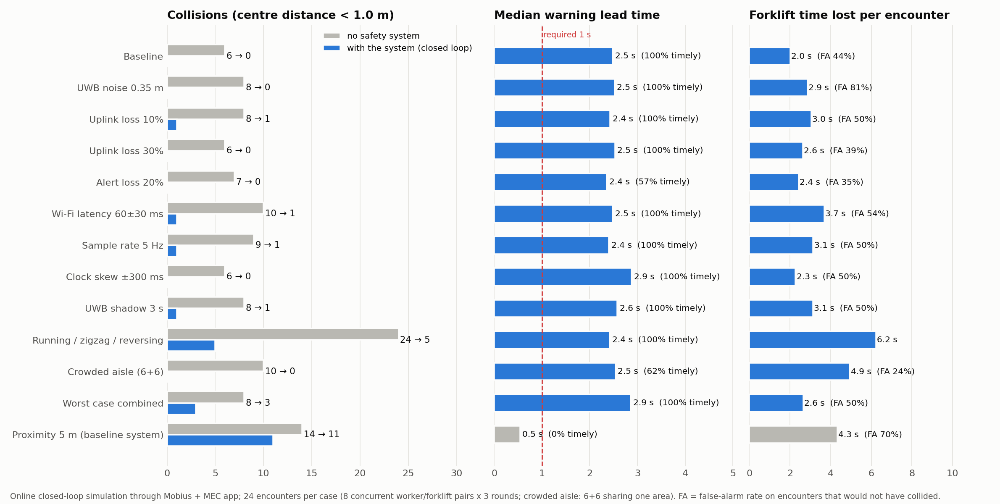
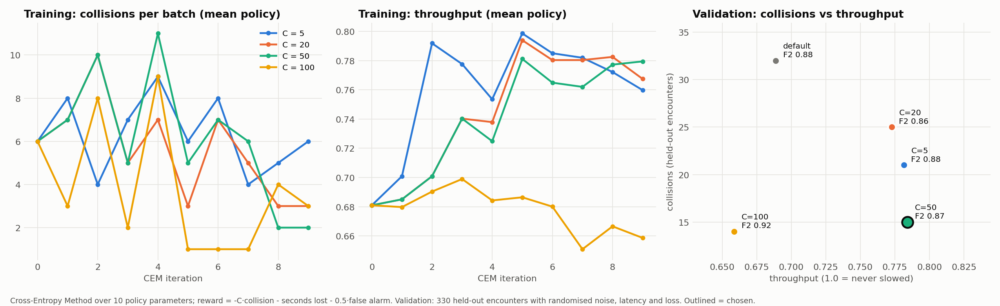
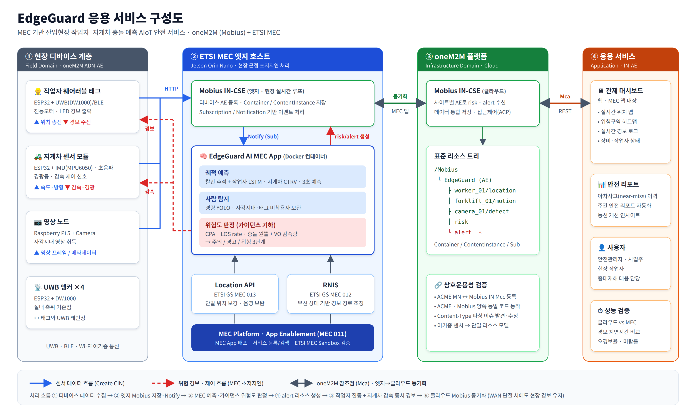

# EdgeGuard

MEC 기반 산업현장 작업자–지게차 충돌 예측 AIoT 안전 서비스
(2026 oneM2M International Hackathon · Team EdgeGuard, Sejong University)

작업자 태그와 지게차 센서 데이터를 **oneM2M**으로 수집하고, **ETSI MEC** 엣지의 위험도 엔진이
충돌을 1~3초 전에 예측해 **작업자 진동 + 지게차 감속** 경보를 보냅니다.

```
디바이스 ──CIN──▶ oneM2M CSE ──Notify──▶ MEC 앱 (추적 → 예측 → 가이던스 판정)
   ▲                  │                          │
   └──── alert Notify ┴────── risk / alert CIN ◀─┘
```

## 현재 상태 (v0.9)

**검증 범위**: 하드웨어 실기 시험은 하지 않습니다. 기능 검증은 온라인 · 고속 폐루프 시뮬레이션, 실제 Mobius/ACME CSE,
MEC 서비스 대역(`mec_mock`, `tools/mec_ipe.py`)과 자체 Sandbox 시나리오로 하고, **공개 ETSI MEC Sandbox(try-mec.etsi.org)와의
실제 연동**은 팀 노트북에서 확인했습니다 (아래 "실제 ETSI MEC Sandbox 연동").
펌웨어는 PC 타입 검사와 Python 기준 구현과의 교차 테스트까지 마친 참조 구현입니다.

| 구성 | 상태 |
|---|---|
| 가이던스 위험도 엔진 (CPA/TCPA, LOS rate, collision cone, VO 감속량) | ✅ 구현 · 단위테스트 |
| 칼만 추적기, CV/CTRV 예측 (통로 격자 회전 제한) | ✅ |
| 창고 시나리오 시뮬레이터 8종 + 비교 실험 | ✅ 결과는 아래 |
| oneM2M 클라이언트, 리소스 트리/구독 셋업 | ✅ ACME CSE와 **KETI Mobius 3.0.1** 양쪽에서 검증 |
| MEC 앱 (FastAPI, 알림 수신 → risk/alert 게시, 디바운스·홀드) | ✅ end-to-end 검증 |
| 작업자 궤적 LSTM (3 s 예측) | ✅ v2: 이상 행동까지 학습, 위험도 엔진에 연결 (`guidance_lstm`, 기본값은 CTRV — 아래) |
| 관제 대시보드 (실시간 맵, 예측 경로, 위험도, 경보 로그) | ✅ MEC 앱 `/`에서 서빙 |
| 가상 디바이스 (실기 도착 전 대체) | ✅ |
| ETSI MEC Location API(013) · RNIS(012) 연동 | ✅ 해커톤 Sandbox 방식(MEC-IPE → CSE 리소스)으로 정렬, 자체 시나리오 종단 검증, **공개 ETSI MEC Sandbox 실연동 확인** (`results/etsi_sandbox_live.json`), **자체 설치 Sandbox에서 창고 시나리오 경보 70건** (`results/sandbox_selfhosted_live.json`) |
| 카메라 사람 탐지 (YOLOv8n) + 태그 없는 작업자 융합 | ✅ |
| 디바이스별 접근제어 (ACP) | ✅ Mobius에서 위조 쓰기 차단 확인 |
| 아차사고 히트맵 · 안전 리포트 | ✅ `tools/safety_report.py` |
| 데모 영상 | ✅ `results/edgeguard_demo.mp4` (4개 장면, 약 1분) |
| ESP32 펌웨어 (작업자 태그, 지게차 모듈) | ✅ UWB 측위(최소제곱 + NLOS 배제), 적응형 주기, 지게차 페일세이프. PC에서 타입 검사 · 로직은 Python과 교차 검증 (참조 구현) |
| MEC 호스트 배포 (Docker) | ✅ MEC 앱 · Mobius 이미지 + Compose 스택. CI에서 빌드 · 종단 시험 · 재시작 시험 후 GHCR에 게시 |
| 배포 구조 결정 (4개 후보 측정) | ✅ 엣지 Mobius + 클라우드 동기화, 아래 "배포 구조" |
| ACME MN-CSE ↔ Mobius IN-CSE 등록(Mcc) | ✅ 검증 (상호운용성 시험) |
| 클라우드 사본 저장 후 전송 (WAN 단절 대비) | ✅ 25 s 단절 중 경보 56건 전부 복구, 중복 0 |
| 적응형 보고 주기 (규모 확장) | ✅ 40대에서 경보 지연 p95 1,642 → 256 ms |
| MEC 앱 재시작 · 디바이스 페일세이프 | ✅ 재시작 1.2~2.2 s, 침묵 2 s 넘으면 지게차 정지 |
| Mobius 설치 스크립트 · CI | ✅ `scripts/setup_mobius.sh`, GitHub Actions (테스트 + 펌웨어 타입 검사) |

## 위험도 판정: 가이던스 기하

`r = p_worker − p_forklift`, `v = v_worker − v_forklift`

| 양 | 식 | 의미 |
|---|---|---|
| LOS rate | λ̇ = (r × v) / R² | 시선각 변화율. **λ̇≈0 이면서 접근 중 = 충돌 코스 (CBDR)**, 비례항법(PN)의 원리 |
| CPA 거리 | d_cpa = R²·\|λ̇\| / \|v\| | 최근접 거리를 LOS rate로 쓴 형태 |
| TCPA | −(r·v) / \|v\|² | 최근접까지 남은 시간 |
| ZEM | R²·\|λ̇\| / Vc | PN의 zero-effort miss (참고값) |
| Collision cone | ∠(−v, r) < asin(R_safe/R) | 상대속도가 충돌 원뿔 안 |
| VO 감속량 | 속도를 k배 했을 때 원뿔을 벗어나는 최대 k | 지게차 `speed_scale` 명령 |

지게차는 IMU yaw rate로 **CTRV** 예측을 하고, 회전은 다음 통로 방향(90° 격자)까지만 이어진다고 봅니다.

| 단계 | 조건 (기본값) | 동작 |
|---|---|---|
| DANGER | 예측 최소거리 < 1.5 m, 1.5 s 이내 | 진동 + 감속(VO) |
| WARNING | < 1.8 m, 3 s 이내 | 진동 + 경광등 |
| CAUTION | < 2.5 m, 5 s 이내 | 대시보드 표시만 |

## 비교 실험 (시뮬레이션)

`python -m sim.evaluate --n 250` → `results/evaluation.json`, `python sim/plot_results.py` → `results/evaluation.png`

8개 시나리오 × 250회 = 2,000회, UWB 잡음 0.15 m, 모든 방식에 동일한 0.3 s 디바운스 적용.
"적시 감지" = 접촉(1.5 m 이내) 1초 전 이상 경보.

| 방식 | 적시 감지 | 오경보율 | 리드타임(중앙값) |
|---|---|---|---|
| 근접 3 m | 0.0% | 66.7% | 0.4 s |
| 근접 5 m | 76.3% | 84.8% | 1.2 s |
| TTC < 3 s | 100.0% | 72.6% | 2.1 s |
| 가이던스 (CPA/LOS) | 100.0% | 31.6% | 2.1 s |
| 가이던스 + CTRV | 100.0% | 33.8% | 2.4 s |
| **가이던스 + CTRV + LSTM** | **100.0%** | **29.8%** | **2.4 s** |

- v0.5에서 "차로 안에 서 있는 작업자" 규칙(아래 온라인 시뮬레이션 참고)을 넣으면서 리드타임이 2.2 → 2.4 s로 늘고,
  오경보는 CTRV 28.6 → 33.8%, LSTM 24.9 → 30.0%로 늘었습니다. 대부분 `turn_away`(지게차가 서 있는 작업자 쪽으로 오다가 꺾는 경우)입니다.
  폐루프에서 충돌을 막는 데 필요한 규칙이라 이 비용을 받아들였습니다.
- LSTM은 잡음 섞인 위치에서 정지한 작업자를 걷는 것으로 오인하는 문제를 줄여, `roadside_picker` 오경보를 52 → 15건으로 줄였습니다.
- 남은 오경보의 대부분은 `worker_yields`(충돌 경로로 오다가 2~3 m 앞에서 감속·정지하는 작업자)입니다.
  감속을 시작하기 전에 이미 충돌 코스이므로, 3초 전 경보는 어떤 방식으로도 피하기 어렵습니다.
- 직접 만든 시나리오에서의 결과이므로, W6에 RC카 실측으로 다시 검증합니다.

### LSTM 궤적 예측

`python -m sim.train_lstm --n 400 --epochs 15` (CPU 약 2.5분) → `models/worker_lstm.pt`

입력: 작업자 위치 20개(최근 1.9 s를 10 Hz로 재표본) + 지게차 상대 위치·속도 / 출력: 0.1~3.0 s 미래 위치 30개.
학습과 평가는 서로 다른 시드의 에피소드를 씁니다.

v2는 기본 8종에 달리기·지그재그·후진 지게차를 더해 학습했습니다. 같은 검증 묶음으로 비교 (3 s 예측 오차 ADE / FDE):

| 모델 | 기본 시나리오 | 이상 행동 (달리기·지그재그·후진) |
|---|---|---|
| 등속 칼만 | 0.31 / 0.54 m | 0.73 / 1.19 m |
| LSTM v1 | **0.175 / 0.29 m** | 0.94 / 1.58 m (등속보다 나쁨) |
| **LSTM v2 (채택)** | 0.184 / 0.31 m | **0.50 / 0.77 m** |

**폐루프에서는 CTRV가 기본값입니다.** 학습된 정책으로 같은 330개 조우를 돌리면 충돌이 CTRV 15건, LSTM 23건이었고,
정책을 LSTM에 맞춰 다시 학습해도 최선이 22건이었습니다 (`results/closed_loop_ctrv_vs_lstm.json`, `results/policy_training_lstm.json`).
예측 오차가 작아도 경보 타이밍이 정책과 맞지 않으면 안전 성능이 더 낫지 않았기 때문에, LSTM은 선택 옵션으로 둡니다.

**불규칙한 샘플 (v0.8)**: 망에서는 샘플이 빠지거나 흔들리고, 적응형 보고 주기는 먼 작업자를 2 Hz로 보냅니다. v0.7은 마지막 20개 샘플을
0.1 s 간격으로 보고 넣었기 때문에 5 Hz에서 속도를 2배로 읽었습니다. 이제 `edgeguard.learned.resample()`이 최근 1.9 s를 **시간 기준으로
10 Hz 격자에 보간**해 넣고, 0.8 s보다 긴 공백이 있으면 등속 예측으로 돌아갑니다 (`sim/lstm_irregular.py`, 처음 보는 조우 3,080개, ADE / FDE m):

| 샘플 조건 | v0.7 (순서 기준) | v0.8 (시간 기준) | 등속 칼만 |
|---|---|---|---|
| regular 10 Hz | 0.26 / 0.40 | **0.26 / 0.40** | 0.41 / 0.68 |
| jitter +-40 ms | 0.26 / 0.42 | **0.26 / 0.42** | 0.42 / 0.71 |
| 20 % uplink loss | 0.38 / 0.66 | **0.27 / 0.42** | 0.45 / 0.75 |
| 40 % loss + jitter | 0.72 / 1.33 | **0.30 / 0.46** | 0.52 / 0.86 |
| 5 Hz | 1.05 / 1.96 | **0.29 / 0.45** | 0.49 / 0.82 |
| adaptive 2 Hz -> 10 Hz | 0.69 / 1.17 | **0.28 / 0.44** | 0.42 / 0.69 |

v0.8은 모든 조건에서 등속보다 낫고, 손실 · 저주기에서 v0.7 대비 오차가 1/2~1/4입니다. 공백 기준은 0.35 / 0.55 / 0.8 s를 비교해 골랐습니다
(`results/lstm_irregular.json`). 재학습은 하지 않았습니다(모델 입력이 다시 10 Hz 격자가 되므로).

PyTorch가 필요하므로 `pip install -r requirements-ml.txt` 후 `mec.method: guidance_lstm`으로 켭니다.
기본값은 PyTorch 없이 도는 `guidance_ctrv`입니다.

## 온라인 폐루프 시뮬레이션 (현장 실측 대체)

`python -m sim.online_sim --cases all` → `results/online_sim.json`, `python sim/plot_online.py` → `results/online_sim.png`



RC카 실측 대신, 실제 스택(Mobius → MEC 앱 → 경보) 전체를 실시간으로 돌리는 시뮬레이션입니다.
가상 기기는 경보에 **실제로 반응**합니다: 지게차는 받은 속도 제한까지 감속(액추에이터 지연 0.2 s, 감속 2.5 m/s²),
작업자는 진동을 받으면 0.8 s 뒤 멈춥니다(2 s). 케이스마다 작업자·지게차 8쌍을 동시에 3라운드(24회) 돌리고,
통신·센서 결함을 주입합니다. "충돌" = 중심 거리 1.0 m 미만.

| 케이스 | 주입한 조건 | 충돌 (시스템 없음 → 있음) | 적시 감지 | 리드타임 | 경보 지연 p95 | 지게차 손실 시간 |
|---|---|---|---|---|---|---|
| 기준 | UWB 잡음 0.15 m, 10 Hz | 6 → **0** | 100% | 2.5 s | 115 ms | 2.0 s |
| 센서 잡음 | UWB 0.35 m | 8 → **0** | 100% | 2.5 s | 94 ms | 2.9 s |
| 상향 손실 10% | 센서 샘플 유실 | 8 → 1 | 100% | 2.4 s | 89 ms | 3.1 s |
| 상향 손실 30% | 센서 샘플 유실 | 6 → **0** | 100% | 2.5 s | 86 ms | 2.6 s |
| 경보 손실 20% | 하향 경보 유실 | 7 → **0** | 57% | 2.4 s | 114 ms | 2.4 s |
| Wi-Fi 지연 | 양방향 60±30 ms | 10 → 1 | 100% | 2.5 s | 263 ms | 3.7 s |
| 샘플링 5 Hz | 전송 주기 절반 | 9 → 1 | 100% | 2.4 s | 110 ms | 3.1 s |
| 시계 오차 | 기기별 ±300 ms | 6 → **0** | 100% | 2.9 s | – | 2.3 s |
| UWB 음영 | 작업자 태그 3 s 끊김 | 8 → 1 | 100% | 2.6 s | 93 ms | 3.1 s |
| 이상 행동 | 달리기·지그재그·후진 지게차 | 24 → 5 | 100% | 2.4 s | 144 ms | 6.2 s |
| 밀집 통로 | 6+6대가 한 구역 공유 | 10 → **0** | 62%* | 2.5 s | 87 ms | 4.9 s |
| 최악 복합 | 잡음+손실+지연+시계오차+음영 | 8 → 3 | 100% | 2.9 s | – | 2.7 s |
| 근접 5 m 방식 (비교) | 기존 근접 경보, 감속 30% | 14 → 11 | 0% | 0.5 s | 98 ms | 4.3 s |

- EdgeGuard 12개 케이스 합계 **충돌 110 → 12건 (89% 감소)**. 같은 조건의 근접 5 m 방식은 14 → 11건(21%)이고 지게차 손실 시간도 더 깁니다.
- *밀집 통로의 적시 감지 62%는 과소 평가입니다. 다른 쌍 때문에 이미 멈춘 작업자·지게차는 원래(무반응) 시간표의 충돌이 일어나지 않는데,
  감지는 원래 시간표 기준으로 재기 때문입니다. 이 케이스의 실제 충돌은 0건입니다.
- 경보 손실 20%에서 적시 감지가 떨어져도 충돌이 0인 것은 1초마다 다시 보내는 경보가 유실을 메우기 때문입니다.
- 남은 약점: **지그재그로 걷는 작업자**(예측이 흔들림)와 **후진 지게차**에 다가가는 작업자. 이상 행동 케이스 24건 중 5건이 충돌했습니다.

시뮬레이션이 찾아낸 제어 문제와 v0.5에서 고친 내용:
1. **감속 후 해제 → 재가속 충돌**: 지게차가 느려지면 예측상 위험이 사라져 경보가 풀리고, 다시 빨라진 뒤 충돌.
   → 차로 안에 서 있는 작업자는 시간과 무관하게 경보 유지, 경보 해제 대기 2 s, 지게차는 해제 신호(또는 5 s 무응답)까지 제한 유지.
2. **비율 명령의 함정**: "현재 속도의 ×0.6"은 이미 느려진 속도 기준이라 다시 빨라질 수 있음 → 경보에 **절대 속도 제한(m/s)** 추가.
3. **작업자 정지와 감속 계획의 충돌**: 진동을 받은 작업자가 차로 한가운데에서 멈추면 "조금만 감속" 명령으로는 부딪힘
   → 감속량을 "반응 시간 뒤 멈추는 작업자" 기준과 정지거리 기준 중 엄격한 쪽으로 계산.
4. **진동 남발**: 1초마다 진동하면 작업자가 계속 멈춤 → 새 경보·DANGER·아직 걸어 들어오는 작업자에게만 진동.
5. **MEC 과부하**: 16대 × 10 Hz에서 샘플마다 모든 쌍을 계산해 경보 지연이 1.1 s까지 증가
   → 새 샘플이 온 기기와 관련된 쌍만, 도달 불가능한 쌍은 예측 생략. 경보 지연 p50 60~80 ms로 회복.
6. **후진 지게차**: IMU 방향(앞)과 실제 진행 방향(뒤)이 반대 → 움직이는 중에는 속도 벡터 방향으로 예측.

## 정책 학습 (보상함수 + 평가함수)

`python -m sim.train_policy` → `results/policy_training.json`, `config/policy_trained.yaml`, `python sim/plot_policy.py`



경보·감속 정책의 파라미터 10개(경보 시점 `t_warn`·`t_danger`, 여유 거리, 작업자 반응 가정, 제동 감속도·여유,
차로 확인 거리, 통과 속도, 해제 대기, 정지 판정 속도)를 학습했습니다. 정책 코드(`edgeguard/alerting.py`)는 MEC 앱과
시뮬레이터가 같이 쓰므로, 학습한 것이 그대로 현장에서 돕니다.

- **학습기**: Cross-Entropy Method (기울기 없는 정책 탐색), 후보 14개 × 10회, 후보끼리 같은 조우로 비교.
  학습용 고속 폐루프 시뮬레이터 `sim/closed_loop.py`(실시간 온라인 시뮬과 같은 로직, 초당 약 23회).
- **조건 무작위화**: 조우마다 UWB 잡음 0.1~0.35 m, 지연 40~220 ms, 상향 손실 0~20%, 경보 손실 0~10%, 11개 시나리오(이상 행동 포함).
- **보상함수** (조우당, 최대화):

  `r = − C · 충돌 − 지게차 손실 시간(s) − 0.5 · 불필요 경보`

  C는 "충돌 1건을 지게차 몇 초와 바꿀 것인가"이므로 5, 20, 50, 100으로 바꿔 각각 학습했습니다.
- **평가함수** (학습에 안 쓴 330개 조우, 무작위 조건):
  - Precision = 실제 충돌 위험에 울린 경보 / 전체 경보, Recall = 접촉 1초 전 이상 경보한 위험 / 전체 위험
  - **F-β, β = 2**: 사고 놓침(Recall)을 불필요 경보(Precision)보다 무겁게
  - 처리량 = 실제 지게차 주행 거리 / 감속 없이 갔을 거리
  - **선택 규칙**: 안전 우선(충돌 수가 가장 안전한 후보의 10%+1건 이내)인 후보 중 `F2 × 처리량 / 기존 처리량`이 최대인 것

| 정책 | 충돌 | Recall | Precision | F2 | 처리량 | 조우당 손실 | 점수 |
|---|---|---|---|---|---|---|---|
| 기존 (수동 설정) | 32/180 | 0.944 | 0.694 | 0.881 | 0.689 | 3.8 s | 탈락 |
| C = 5 | 21/180 | 0.950 | 0.676 | 0.879 | 0.781 | 2.7 s | 탈락 |
| C = 20 | 25/180 | 0.933 | 0.641 | 0.855 | 0.773 | 2.8 s | 탈락 |
| **C = 50 (채택)** | **15/180** | 0.950 | 0.653 | 0.871 | **0.784** | **2.7 s** | **0.991** |
| C = 100 | 14/180 | 0.978 | 0.759 | 0.924 | 0.659 | 4.1 s | 0.884 |

- C가 너무 작으면(5, 20) 처리량은 오르지만 충돌이 남고, 너무 크면(100) 충돌은 가장 적지만 지게차가 자주 서서 처리량이 기존보다도 떨어집니다.
  **C = 50**이 충돌을 기존의 절반 이하(32 → 15)로 줄이면서 처리량을 14% 올린 지점입니다.
- 학습된 정책은 경보를 더 일찍(3.0 → 4.1 s) 주고, 감속은 덜 급하게 하되 통과 속도를 높여(1.0 → 1.7 m/s) 멈춰 서는 시간을 줄입니다.

**실시간 온라인 시뮬레이션 검증** (같은 4개 케이스, `results/online_policy_*.json`):

| 정책 | 충돌 (기준·이상 행동·Wi-Fi 지연·최악 복합 합계) | 리드타임 | 지게차 손실 시간 | 오경보율 |
|---|---|---|---|---|
| 기존 | 48 → 8 | 2.5 s | 3.4 s | 25~56% |
| **학습** | **48 → 3** | **3.5 s** | **2.4 s (−27%)** | 67~77% |

- 사고는 더 줄고 지게차 손실 시간도 줄었습니다. 대가로 오경보율이 올랐는데, β = 2로 Recall을 우선하도록 설계한 결과입니다.
  경보는 늘었지만 멈춰 서는 시간은 오히려 짧아져 업무 처리 속도는 유지·향상되었습니다.
- `config/site.yaml`에 학습된 정책을 반영했습니다. 위 "온라인 폐루프 시뮬레이션" 표는 반영 전(기존 정책) 결과입니다.

## v0.9: 단말 간 협력 (D2D) — 터널 속 자율주행차처럼

터널에 들어간 자율주행차가 서로 통신하듯, 망이 끊기거나 일부 단말이 전파 음영(금속 랙 뒤)에 들어가도 단말끼리 직접 주고받습니다.

1. **상태 방송**: 모든 단말이 보고 주기마다 자기 상태 `{x, y, vx, vy, mecOk}`를 ESP-NOW로 직접 방송합니다(공유기 불필요, 수 ms).
   위치는 UWB 앵커가 망과 무관하게 계속 주므로 망이 끊겨도 방송은 계속됩니다. 실제 5G 현장에서는 같은 프레임을 사이드링크(PC5)에 싣습니다.
2. **로컬 2차원 예측**: MEC가 2 s 넘게 조용하면, 상대 상태가 신선한(0.5 s 이내) 경우 v0.8의 거리 · 접근속도 대신
   **등속 최근접점(CPA)** 으로 판단합니다. 나란히 걷는 작업자는 멈출 이유가 아니고, 교차해 올 작업자만 멈춥니다. 상태가 끊기면 v0.8 규칙으로 돌아갑니다.
3. **중계 (부분 장애)**: MEC를 아직 듣는 단말이, `mecOk = 0`을 알린 이웃에게 MEC 경보 · 하트비트를 대신 전달하고(1홉, 3번 반복),
   이웃의 위치를 대신 CSE에 올립니다. 음영 속 단말이 연결된 것처럼 동작합니다.

`sim/failsafe_eval.py` (실충돌 180, 단말별 링크 · 음영 조건 추가, `results/failsafe_eval.json`, 그림 `results/failsafe_eval.png`):

| 장애 시 동작 (충돌 · 처리량) | 정상 | MEC 8 s 다운 | 망 단절 | 지게차 음영 8 s | 작업자 음영 8 s |
|---|---|---|---|---|---|
| v0.7: 유지 → 정지 | 20 / 77 % | 85 / 68 % | 180 / 100 % | 52 / 68 % | 66 / 83 % |
| 참고: 모든 지게차 정지 | 10 / 67 % | 25 / 42 % | 2 / 18 % | 5 / 43 % | 52 / 72 % |
| v0.8: 로컬 UWB | 19 / 77 % | 40 / 59 % | 3 / 54 % | 34 / 60 % | 51 / 82 % |
| D2D 상태 교환만 (중계 없음) | 23 / 76 % | 35 / 59 % | 2 / 57 % | 39 / 60 % | 38 / 81 % |
| **v0.9: D2D + 중계 (채택)** | **23 / 76 % | 35 / 59 % | 2 / 57 % | 19 / 76 % | 16 / 76 %** |

- **음영 지역에서 가장 큰 차이**: 작업자 음영 66 → 16, 지게차 음영 52 → 19이면서 처리량은 정상과 같은 76 %(모든 지게차 정지는 43 %).
  중계가 없으면(상태 교환만) 38 · 39건이라, 효과의 대부분은 중계에서 나옵니다.
- 망 전체 단절 · MEC 다운에서는 v0.8과 비슷하거나 조금 낫습니다(2 대 3, 35 대 40). 정상 · 짧은 재시작 차이는 표본 오차 수준입니다.
- **D2D 링크가 나빠져도** (`sim/d2d_sensitivity.py`, `results/d2d_sensitivity.json`, 충돌 / 180):

| D2D 조건 | 지게차 음영 | 작업자 음영 | MEC 8 s 다운 | 망 단절 |
|---|---|---|---|---|
| assumed (10 % loss, 40 m) | 19 | 16 | 35 | 2 |
| 30 % frame loss | 21 | 19 | 34 | 2 |
| 60 % frame loss | 26 | 20 | 34 | 3 |
| range 15 m | 19 | 20 | 36 | 2 |
| 60 % loss + 15 m | 24 | 17 | 36 | 4 |

  처음엔 중계 프레임을 1번만 보냈더니 프레임 손실 60 %에서 지게차 음영 48건으로 **중계가 없을 때(34)보다 나빴습니다**
  (드문드문 오는 하트비트 때문에 로컬 판단이 꺼진 채 경보는 빠짐). 중계 프레임을 3번 반복해 26건으로 고쳤습니다.
- 규칙은 `edgeguard/device_policy.py`와 `firmware/common/device_policy.h`(`cpaCap`)에 같이 있고 교차 테스트 · 변이 테스트로 확인합니다.
  프레임 형식과 중계 장부는 `firmware/common/d2d.h`(크기 ≤ 250 B, 수신은 Wi-Fi 태스크에서 큐로 넘김),
  두 스케치에 ESP-NOW 송수신 · 중계가 들어 있습니다(PC 타입 검사 통과). 음영 속 단말은 HTTP가 루프를 막지 않도록 2 s마다만 직접 전송을 시도합니다.
- 한계: ESP-NOW는 AP와 같은 채널을 써야 하고, 실제 전파 손실 · 거리는 실기에서 확인해야 합니다. 메시지 인증(가짜 프레임으로 정지 유발)은 다루지 않았습니다.

## v0.8: 망 장애 대안 — 단계적 강등 (MEC 예측 → 로컬 UWB → 정지)

v0.7의 페일세이프는 MEC가 **이미 경보를 낸 쌍**만 지켰습니다. MEC·망이 끊긴 동안 새로 나타난 작업자는 아무도 보지 못해,
망이 조우 전체 동안 끊기면 실충돌 180건이 모두 충돌로 이어졌습니다. v0.8은 장애 시 판단을 지게차로 내립니다.

1. **정상: MEC 예측** — 현장 전체를 보고 충돌 시점을 예측 (오경보가 적고 리드타임이 김).
2. **MEC 침묵 2 s 이상: 로컬 UWB** — 지게차 모듈이 작업자 태그와 직접 UWB 거리 측정(앵커와 하는 DW1000 양방향 측정을 태그 상대로)을 하고,
   거리와 **접근 속도(거리 변화율)로 계산한 TTC**로 판단합니다: 3 m 이내 또는 TTC 2 s 미만이면 정지, 6 m 이내 또는 TTC 4 s 미만이면 1 m/s.
   양방향 측정은 양쪽 모두 거리를 알게 되므로, **작업자 태그도 같은 규칙으로 진동**해 작업자가 멈춥니다.
3. **제한 중인데 MEC가 계속 침묵: 정지** (v0.7 규칙 유지). MEC가 다시 들리면 바로 MEC 예측으로 돌아갑니다.

`sim/failsafe_eval.py`, 고속 폐루프 330개 조우(실충돌 180), 같은 조우·같은 망 조건 (`results/failsafe_eval.json`, 그림 `results/failsafe_eval.png`; v0.9 시뮬레이터로 다시 잰 값):

| 침묵 시 동작 (충돌 · 처리량) | 정상 | 재시작 1.7 s | 재시작 + 손실 20 % | MEC 8 s 다운 | 망 단절 (조우 전체) |
|---|---|---|---|---|---|
| v0.7: 유지 → 2 s 뒤 제한 중이면 정지 | 20 / 77 % | 40 / 75 % | 41 / 74 % | 85 / 68 % | 180 / 100 % |
| 참고: 침묵 2 s면 모든 지게차 정지 | 10 / 67 % | 28 / 66 % | 31 / 64 % | 25 / 42 % | 2 / 18 % |
| 로컬 거리 구역만 | 20 / 77 % | 43 / 75 % | 43 / 73 % | 62 / 60 % | 37 / 62 % |
| 로컬 거리 + 접근속도(TTC) | 19 / 77 % | 43 / 74 % | 41 / 72 % | 60 / 59 % | 30 / 60 % |
| **v0.8: 로컬 TTC + 태그 진동** | **19 / 77 % | 43 / 74 % | 43 / 72 % | 40 / 59 % | 3 / 54 %** |

- **망이 완전히 끊겨도 충돌 180 → 3**, 지게차는 54 %로 계속 일합니다(MEC 8 s 다운 85 → 40). "모든 지게차 정지"는 충돌 2건이지만 처리량이 18 %로 떨어집니다.
- 정상 · 짧은 재시작에서는 v0.7과 차이가 표본 오차 수준입니다(로컬 규칙은 MEC가 2 s 넘게 침묵할 때만 켜짐).
  켜지는 시점 1.3 / 2.0 / 3.0 s를 훑어 2.0 s를 골랐습니다.
- 거리만 보는 구역(상용 UWB 방식)보다 접근 속도를 쓰는 쪽이, 지게차만 멈추는 것보다 작업자 태그까지 진동하는 쪽이 매번 나았습니다.
- 규칙은 `edgeguard/device_policy.py`와 `firmware/common/device_policy.h`(`LocalGuard`)에 같이 들어 있고, 무작위 거리·하트비트 열로
  두 구현을 비교하는 테스트가 있습니다(상수 변경을 잡는지 변이 테스트로 확인).
- **추가 프로토콜 없이 직접 측정**: 지게차 모듈의 DW1000을 *움직이는 앵커*(짧은 주소 `0x20NN`)로 띄웁니다. 작업자 태그는 원래 하던
  앵커 측정 라운드에서 지게차 앵커와도 거리를 재게 되고, 양방향 측정이라 지게차도 같은 거리를 압니다
  (`firmware/forklift_module` `onPeerRange`, `firmware/worker_tag` `onNewRange`). 태그는 이 거리를 위치 계산에 쓰지 않고 로컬 규칙에만 씁니다.
  arduino-dw1000은 기본 4개 장치까지만 재므로 `MAX_DEVICES`를 8로 올립니다(고정 앵커 4 + 지게차 4). 지게차 위치는 별도 태그 보드가 맡습니다
  (DW1000 하나가 앵커와 태그를 동시에 할 수 없음).
- **가정이 나빠져도 견디는지** (`sim/peer_ranging_sensitivity.py`, `results/peer_ranging_sensitivity.json`, 충돌 / 실충돌 180, v0.7은 75 / 180):

| 직접 측정 조건 | MEC 8 s 다운 | 망 단절 |
|---|---|---|
| assumed (10 Hz, 10 % miss, 0.1 m, 30 m) | 31 | 3 |
| 5 Hz (crowded channel) | 31 | 4 |
| 2 Hz (very crowded) | 41 | 7 |
| 40 % missed rounds (NLOS) | 31 | 2 |
| noise 0.3 m | 28 | 3 |
| NLOS bias +0.5 m | 34 | 5 |
| max range 12 m | 28 | 3 |
| all bad (5 Hz, 40 %, 0.3 m, +0.5 m, 12 m) | 47 | 23 |

  측정 주기가 2 Hz로 떨어져도(태그가 몰려 채널이 붐빔) 쓸 수 있도록 접근속도 창을 1.5 s, 측정 유효 시간을 1.2 s로 정했습니다
  (0.6 / 0.5 s일 때 2 Hz에서 망 단절 충돌 41 → 7). 모든 조건이 동시에 나빠도 v0.7(180)보다 훨씬 적습니다(23).
- 남은 한계: 무선 측정 자체는 실기에서 확인해야 합니다(측정 주기 · 다중 태그 충돌 · 금속 랙 NLOS).

## v0.7: 신뢰성 · 규모 확장

### 규모: 적응형 보고 주기
모든 샘플은 CSE에서 쓰기 1회 + MEC 앱 알림 1회가 되므로, 현장 전체 샘플 수가 규모의 한계입니다.
`edgeguard/rate_control.py`: 주변에 상대가 가깝거나 다가오는 기기만 10 Hz, 나머지는 2 Hz.
판정은 `d < 8 m + 2 s × (두 속도 합 + 0.5)` 또는 `실제 접근 속도로 5 s 안에 도달`이고, 느려지는 쪽에만 3 s 유지 · 20 % 여유를 둡니다.
명령은 `<ae>/control`로 보내고 1 s마다 전체 표를 다시 보내므로, 명령이 유실돼도 스스로 복구됩니다. 기기는 6 s 동안 명령이 없으면 10 Hz로 돌아갑니다.

온라인 시뮬레이션 (`results/online_robustness.json`, 2코어 PC 한 대에 디바이스·Mobius·DB·MEC 앱을 모두 올린 보수적 조건):

| 케이스 | 기기 | 충돌 (없음 → 있음) | 적시 감지 | 경보 지연 p50 / p95 | 보낸 샘플 |
|---|---|---|---|---|---|
| 기준 | 16 | 8 → 0 | 100 % | 58 / 79 ms | 5,744 |
| 기준 + 적응형 | 16 | 8 → 1 | 100 % | 57 / 78 ms | 5,750 |
| 설계 부하 | 24 | 8 → 0 | 100 % | 74 / 95 ms | 5,760 |
| 40대 (모두 조우) | 40 | 13 → 3 | 100 % | 352 / 1,044 ms | 8,979 |
| 40대 (절반은 떨어져 작업) | 40 | 11 → 2 | 100 % | 459 / 1,642 ms | 13,292 |
| **같은 조건 + 적응형** | 40 | 11 → 1 | 100 % | **94 / 256 ms** | **11,573 (−13 %)** |

40대 시험은 PC 부하에 민감합니다. 세 번의 측정에서 적응형 없이는 지연 p95 0.46~3.4 s · 충돌 11 → 1~9건, 적응형을 켜면 매번 0.21~1.1 s · 11 → 1건이었습니다 (위 표는 경보 상태 버그 수정 후 최신 측정).
기본 부하에서는 아무 기기도 느려지지 않아 결과가 같습니다. 그래서 `rate_control.enabled: true`가 기본값입니다.
MEC 앱의 출력 큐는 우선순위(경보 > 제어 > 위험도 요약)라 경보가 다른 쓰기 뒤에 밀리지 않습니다.

### MEC 앱 재시작 · 지게차 페일세이프
MEC 앱을 조우 도중 강제 종료 · 재시작해도 1.2~2.2 s 만에 경보가 다시 나갑니다 (`mec_restart` 케이스: 충돌 5 → 0~1, 적시 감지 100 %).
MEC가 조용할 때 지게차가 할 일은 측정으로 정했습니다 (`sim/failsafe_eval.py`, 고속 폐루프 330개 조우, 같은 조우·같은 망 조건):

| 침묵 시 동작 (충돌 / 실충돌 180건) | 정상 | 재시작 1.7 s | 재시작 + 경보 손실 20 % | MEC 8 s 다운 |
|---|---|---|---|---|
| v0.6: 마지막 제한 유지, 5 s 뒤 해제 | 19 | 30 | 43 | 93 |
| 침묵하면 즉시 서행 (0.5 m/s) | 20 | 42 | 60 | 94 |
| 침묵하면 즉시 정지 | 20 | 34 | 52 | 60 |
| **유지 → 침묵 2 s 넘으면 정지 (채택)** | **19** | **27** | **42** | **78** |

- 짧은 침묵에 서행 · 정지하면 오히려 충돌이 늘었습니다. 감속 계획은 지게차가 교차점을 먼저 지나가거나 그 앞에서 서도록 짜여 있는데,
  서행하는 지게차는 충돌 구역에 더 오래 머물기 때문입니다. MEC가 계속 없을 때는 정지가 확실히 낫습니다.
- 정지 기준 1.3~3.0 s를 훑어 2.0 s를 골랐습니다 (`results/failsafe_stop_sweep.json`). 모든 조건에서 v0.6보다 같거나 낫습니다.
- MEC는 1 s마다 `<ae>/control`에 하트비트를 보냅니다. 경보보다 우선순위가 낮으므로, 하트비트가 도착했다는 것은 밀린 경보가 없다는 뜻이기도 합니다.
  MEC가 살아 있는데 5 s 동안 갱신이 없으면 "해제" 경보가 유실된 것으로 보고 제한을 풉니다. 침묵만으로는 제한을 절대 풀지 않습니다.
- 규칙은 `edgeguard/device_policy.py`(기준 구현)와 `firmware/common/device_policy.h`(펌웨어)에 똑같이 들어 있고,
  무작위 이벤트 열을 양쪽에 넣어 결과가 같은지 테스트로 확인합니다.

### 클라우드 사본: 저장 후 전송
`edgeguard/cloud_sync.py`: 클라우드로 보낼 경보 · 위험도 요약을 순서 있는 큐에 쌓고, 실패하면 지수 백오프로 재시도합니다.
큐가 차면 위험도 요약부터 버리고 경보는 끝까지 남깁니다. 현장 경보는 별도 경로라 영향이 없습니다.
`python tools/outage_replay_test.py` — 운행 도중 WAN 프록시를 25 s 끊었다가 복구 (`results/outage_replay.json`):

| MEC가 낸 경보 | 단절 중 쌓인 최대 대기열 | 복구 후 클라우드의 경보 | 중복 | 버린 항목 |
|---|---|---|---|---|
| 56 | 43 | **56 (전부)** | 0 | 0 |

### 펌웨어
- 작업자 태그: DW1000 양방향 거리 측정 → `firmware/common/uwb_position.h`(선형화 최소제곱 + 가우스-뉴턴, 앵커 1개 NLOS 배제).
  Python 쌍둥이 `edgeguard/uwb.py`와 같은 결과인지 테스트합니다 (잡음 0.1 m에서 평균 오차 < 0.15 m, NLOS 앵커 +1.5 m 배제).
- 두 스케치 모두 `<ae>/control`의 주기 명령과 하트비트를 처리하고, 지게차는 위 페일세이프 규칙으로 PWM을 제한합니다.
- `tests/test_firmware_build.py`: 실제 ArduinoJson + ESP32 API 스텁으로 두 스케치를 `-Wall -Wextra -Werror` 타입 검사합니다 (CI에서도 실행).

### 설치 · CI
- `scripts/setup_mobius.sh` — Mobius 3 + MariaDB 설치 · 시작 (`install | start | stop | status`). 스키마의 MySQL 8 정렬 규칙을 MariaDB용으로 바꾸고, 대화형 비밀값 설정도 자동으로 처리합니다.
- `.github/workflows/ci.yml` — 푸시마다 Python 3.11에서 전체 테스트 (LSTM 포함, CPU torch) + 펌웨어 타입 검사.

## MEC 호스트 배포 (Docker Compose)

MariaDB + Mobius(oneM2M IN-CSE) + MEC 앱을 한 번에 띄웁니다. 경보 정책 · 적응형 주기 · 접근제어는 `config/site.yaml` 그대로이고,
주소만 `deploy/compose-overrides.yaml`로 덮습니다 (`EDGEGUARD_OVERRIDES`, 깊은 병합).

```bash
cd deploy
docker compose up -d                    # MEC 호스트 스택 (빌드 포함)
docker compose --profile demo up        # + oneM2M 리소스 셋업 + 가상 디바이스 (조우 4회)
python3 check_demo.py out/devices.json http://localhost:9090/health
# 대시보드 http://localhost:9090/ · 실기 디바이스는 http://<호스트>:7579/Mobius 로 접속
```

미리 빌드된 이미지 (저장소가 비공개라 토큰으로 로그인 필요: `read:packages` 권한의 PAT):
```bash
echo $GHCR_TOKEN | docker login ghcr.io -u <GitHub 아이디> --password-stdin
export EDGEGUARD_IMAGE_TAG=latest EDGEGUARD_PULL_POLICY=always   # Windows cmd: set 로 각각 지정
docker compose up -d
```

| 구성 요소 | 이미지 | 비고 |
|---|---|---|
| MariaDB | `mariadb:11.4` | 데이터는 `db-data` 볼륨 |
| Mobius | `ghcr.io/ljw22112/edgeguard-mobius` | 커밋 고정 + 의존성 잠금. 시작 시 `conf.json` 작성 · 봉인 · 스키마 1회 가져오기 |
| MEC 앱 | `ghcr.io/ljw22112/edgeguard-mec` | 비루트 실행, `/health` 상태 검사. 같은 이미지로 셋업 · 가상 디바이스 실행 |

- Mobius는 DB를 `localhost:3306`으로 고정해 접속하므로 MariaDB 컨테이너의 네트워크를 공유하고, 다른 서비스는 별칭 `mobius`로 찾습니다.
- `.github/workflows/docker.yml`: 푸시마다 공식 베이스 이미지로 빌드 → 스택 기동 → 데모 조우 4회 경보 확인
  (`deploy/check_demo.py`: 4회 모두 1 s 이상 전에 경보, 쓰기 실패 0) → DB를 유지한 채 재시작해 다시 확인 → main이면 GHCR 게시
  (`latest`, `sha-<커밋>`).
- 시험 결과 (이 환경, 4회 × 반복 3번): 리드타임 3.6~3.9 s, 경보 지연 중앙값 25~31 ms, 쓰기 실패 0.
- 팀 노트북 실측 (갤럭시 북2 프로 · RAM 8GB, Windows 11 + Docker Desktop/WSL2, `results/deploy_windows_pc.json`): 조우 4회 모두 경보, 리드타임 3.83 / 3.54 / 3.62 / 3.51 s,
  경보 지연 중앙값 58 ms (p95 82 ms), 경보 30건, 쓰기 실패 0.
- 배포 시험에서 버그 하나를 찾아 고쳤습니다: 조우 사이에 추적이 끊기면 짝의 경보 상태가 WARNING으로 남아,
  다음 조우의 첫 경보가 진동이 안 날 수 있는 "refresh"로 나갔습니다. 이제 2 s 이상 평가되지 않은 짝은 새 조우로 시작합니다
  (반복 실행 리드타임 1.1 / 0.8 / 3.7 / 1.3 s → 3.9 / 3.6 / 3.7 / 3.6 s).

## 로컬 데모 (하드웨어 없이)

```bash
pip install -r requirements.txt
scripts/run_local_demo.sh crossing_conflict
```
ACME CSE(오픈소스 oneM2M)를 받아 실행하고, MEC 앱과 가상 디바이스를 띄운 뒤 리소스를 만듭니다.
시나리오: `crossing_conflict crossing_clear head_on adjacent_aisle roadside_picker turn_into_worker turn_away worker_yields`

로컬 실행 시 센서 샘플 → CSE → MEC → CSE → 디바이스 경보까지 중앙값 약 25~35 ms였습니다
(한 대의 PC 안에서 측정, 실제 네트워크 지연 미포함).

## 관제 대시보드

MEC 앱을 띄우고 브라우저에서 `http://<mec-host>:9090/` 를 엽니다.
작업자·지게차 위치, 3초 예측 경로, 예측 최근접 지점(✕와 남은 시간), 안전 반경, 쌍별 위험도 지표, 경보 로그를 0.2초마다 갱신합니다.

## 배포 구조 (측정으로 결정)



**결정: 엣지 Mobius(MEC 호스트) + 클라우드 Mobius, MEC 앱이 클라우드로 동기화** — `config/site.yaml`

후보 4개를 한 대의 PC에서 띄우고, 현장↔클라우드 구간은 `tools/wan_proxy.py`로 단방향 25±5 ms(왕복 약 50 ms)를 걸어 측정했습니다.
충돌 시나리오 6회씩, `python tools/topology_bench.py` → `results/topology_25ms.json`.

| 구성 | 경보 지연 중앙값 / p95 | WAN 단절 시 현장 경보 | 클라우드 사본 | 엣지 CSE 처리량 |
|---|---|---|---|---|
| ① 클라우드 Mobius만 | 85 / 133 ms | ❌ 0건 (전부 중단) | 해당 없음 | — |
| ② 엣지 Mobius만 | 23.5 / 29 ms | ✅ | ❌ 없음 | 250 writes/s 여유 |
| **③ 엣지 Mobius + 클라우드 동기화** | **25 / 52 ms** | **✅ 26/26건 유지** | **✅** | **250 writes/s 여유** |
| ④ 엣지 ACME MN ↔ 클라우드 Mobius (Mcc) | 33 / 43 ms | ✅ 26/26건 유지 | ✅ (MN 재지정) | ❌ 약 110 writes/s에서 포화 |

엣지 CSE 부하 시험 (`tools/cse_load_bench.py`, 디바이스마다 10 Hz, 모든 컨테이너에 구독):

| 디바이스 수 (요청/s) | Mobius 쓰기 p95 | Mobius 알림 p95 | ACME 처리량 | ACME 쓰기 p95 |
|---|---|---|---|---|
| 10 (100) | 10 ms | 12 ms | 100.7/s | 32 ms |
| 25 (250) | 63 ms | 71 ms | **109/s (포화)** | 323 ms |
| 50 (500) | 205 ms (355/s) | 237 ms | 112/s | 642 ms |

판단 근거
- **가용성이 결정적입니다.** ①은 클라우드 연결이 끊기면 경보가 하나도 나가지 않습니다. 안전 시스템으로 쓸 수 없습니다.
  지연 차이(약 60 ms)는 예측 리드타임 2초에 비하면 작지만, 단절 시 동작 차이는 0과 100%입니다.
- **규모에서 ④가 탈락했습니다.** 작업자 20명 + 지게차 5대(10 Hz)면 초당 250건인데, ACME는 약 110건에서 포화되어 지연이 수백 ms로 늘어납니다.
  Mobius는 같은 조건에서 p95 63 ms입니다 (부하 생성기와 같은 2코어 PC에서 측정한 보수적인 값).
- **③이 ②의 성능을 그대로 유지하면서 클라우드 사본을 얻습니다.** 동기화는 별도 큐에서 돌기 때문에 WAN이 느리거나 끊겨도 현장 경보에 영향이 없습니다 (단절 시 실패 74건은 `/health`에 집계).
- 한계: Mobius 3은 IN-CSE 전용이라 엣지와 클라우드 Mobius 사이는 oneM2M Mcc 등록이 아니라 MEC 앱의 동기화입니다.
  표준 Mcc 연동은 ④ 구성(ACME MN → Mobius IN)으로 별도 검증했으며, 저속 게이트웨이(카메라 노드 등)를 붙이는 용도로 남겨 둡니다.

실행 (엣지 서버에 Mobius가 떠 있다고 가정):
```bash
export EDGEGUARD_CONFIG=config/site.yaml      # cloud_sync.base_url만 클라우드 주소로 수정
scripts/mec.sh start
python devices/device_sim.py --config config/site.yaml --start-delay 4 &
python tools/setup_resources.py --config config/site.yaml --reset
```
Mobius 3.x의 CSEBase는 `srv: ["1","2","2a"]`라서 `rvi: "2a"`를 씁니다.

상호운용성 시험에서 찾은 문제와 해결은 [docs/interop-notes.md](docs/interop-notes.md)에 정리했습니다.

## ETSI MEC 서비스 연동

`edgeguard/mec_services.py` (클라이언트), `mec_mock/server.py` (시험용 MEC 플랫폼, ETSI 데이터 모델 부분집합).
`config/site.yaml`의 `mec_services`로 켭니다.

- **Location API (MEC 013)**: 작업자 UWB 태그가 0.5초 이상 끊기면(선반 뒤 음영) 네트워크 기반 위치를 받아
  정확도만큼 큰 잡음으로 추적기에 넣습니다. 대시보드에는 점선 원과 "MEC Location API"로 표시됩니다.
- **RNIS (MEC 012)**: 현장 셀의 PRB 사용률이 80% 이상이면 경보 판정 시간을 0.5초 늘리고 경보 갱신을 2배로 자주 보냅니다.

충돌 시나리오 4회, 첫 경보의 접촉 전 리드타임 (`results/mec_services.json`):

| 조건 | 리드타임 (s) |
|---|---|
| UWB 정상 | 2.48, 2.37, 2.37, 2.27 |
| UWB 3.0~6.5 s 끊김, 폴백 없음 | 2.07, 2.37, **0.87**, 2.27 |
| UWB 끊김 + Location API 폴백 | 2.38, 2.37, 2.28, 2.28 |
| 셀 혼잡 (RNIS 90%) | 2.86, 2.77, 2.97, 3.17 |

폴백이 없으면 한 번은 1초 기준을 못 맞췄고, 폴백을 켜면 정상 때와 같은 수준으로 돌아왔습니다.

### 자체 설치 MEC Sandbox + 창고 시나리오 (AdvantEDGE v1.9.2)

공개 Sandbox는 기본 시나리오만 고를 수 있어, ETSI MEC Sandbox의 오픈소스 기반인 AdvantEDGE v1.9.2를 팀 PC의 Hyper-V VM
(Ubuntu 22.04, Kubernetes 1.27)에 설치하고 **우리 창고 시나리오**(`scenarios/edgeguard-warehouse.json`)를 배포했습니다.
설치 절차와 2026년 현재 깨진 이미지 경로 보정은 `deploy/sandbox-host/` (README · 스크립트)에 있습니다.

경로: AdvantEDGE Location API → MEC-IPE → Mobius 리소스 → 구독 알림 → MEC 앱 → 경보 (`results/sandbox_selfhosted_live.json`)

| 항목 | 결과 (2026-10-08, 2분) |
|---|---|
| 판정 | **CONNECTED** |
| UE 분류 (최고 속도 기준) | 지게차 2 · 작업자 4 — 시나리오와 일치 |
| 위치 수신 | 828회, 6.0 회/s, 미등록 UE 0 |
| 평가한 작업자-지게차 쌍 | 8 |
| **경보** | **70건** |

### 실제 ETSI MEC Sandbox 연동 (try-mec.etsi.org)

팀 노트북(갤럭시 북2 프로, RAM 8GB, Windows 11, Docker Desktop)에서 공개 ETSI MEC Sandbox에 네트워크 시나리오를 배포하고 EdgeGuard 스택을 연결했습니다.
경로: **Sandbox Location API → MEC-IPE → Mobius 리소스 → 구독 알림 → MEC 앱** (MEC API를 앱이 직접 부르지 않음).

```
cd deploy
docker compose up -d --build
docker compose run --rm sandbox-setup https://try-mec.etsi.org/<sbx-id>/mep1/location/v3   # API·UE 탐지 → sandbox/overrides.yaml
docker compose --profile sandbox up -d --force-recreate                                   # MEC-IPE 기동, MEC 앱 Sandbox 모드
docker compose run --rm sandbox-check                                                     # sandbox/report.json, CONNECTED 판정
```

| 항목 | 결과 (2026-10-07) |
|---|---|
| 판정 | **CONNECTED** |
| MEC-IPE가 만든 UE / 셀 컨테이너 | 3 / 10 |
| MEC 앱의 IPE 구독 | 13 |
| 위치 수신 | 32회, 2.0 회/s, 미등록 UE 0 |
| 추적 중인 UE | 2 |

- 대시보드에는 Location API가 v2로 나오지만 실제로는 `location/v3`만 응답합니다. `sandbox_probe`가 두 버전을 모두 시도합니다.
- Sandbox UE는 도시 규모(수백 m 간격)로 움직여 작업자-지게차 쌍이 평가 범위에 들어오지 않았고, 그래서 경보는 0건입니다.
  충돌 위험 판단 성능은 아래 자체 창고 시나리오로 평가합니다.
- 이 시나리오는 셀 부하(layer2_meas)를 주지 않아 혼잡 여유 보정은 꺼진 상태로 동작했습니다.
- Sandbox 모드 해제: `deploy/sandbox/overrides.yaml` 삭제 후 `docker compose up -d --force-recreate mec`.

### 해커톤 MEC Sandbox 정렬 (oneM2M 리소스 경유, MEC-IPE)

운영측 안내(2026-10-06): CSE에 연결된 AE는 MEC 호스트 등록을 CSE가 대신하고, UE 위치는 **MEC-IPE가 CSE 리소스로**
넣어 주며, MEC API 직접 호출보다 oneM2M 리소스 경유를 권장합니다. 팀 고유 지도·궤적으로 **시나리오를 직접 만드는 것**도 권장됩니다.
이에 맞춰 바꾼 것:

- **위치 출처 = CSE (기본값)**: `mec_services.location_source: cse`. MEC 앱이 `<ipe.root>/location/*`, `<ipe.root>/rnis/*`
  컨테이너를 주기적으로 탐색(`fu=1&ty=3`)해 구독하고, 알림의 내용(MEC 013 UserInfo / MEC 012 cellInfo)을 그대로 씁니다.
  `direct`(API 직접 호출)는 비교·탐색용 옵션으로 남겼습니다. 앱 등록(MEC 011)은 하지 않습니다.
- **MEC-IPE 대역** `tools/mec_ipe.py`: TR-0086이 공개 전이라, MEC API를 읽어 CSE에 쓰는 역할을 같은 형식으로 대신합니다.
  리소스 구조는 설정으로 바꿀 수 있어 실제 IPE가 공개되면 경로만 맞추면 됩니다.
- **샌드박스 시나리오** `scenarios/edgeguard-warehouse.yaml` (`tools/sandbox_scenario.py`): 40×24 m 창고, 사설 5G 소형셀 2개, MEC 호스트 1개,
  지게차 2대·작업자 4명이 GeoJSON 경로를 일정 속도로 오가며 주기적으로 마주칩니다. AdvantEDGE 1.8.0 데이터 모델 스키마 검증 통과.
  `mec_mock`이 같은 시나리오를 재생합니다 (`MEC_MOCK_SCENARIO=...`).
- **UWB는 주 출처, MEC 위치는 보조**: 태그 데이터가 0.5 s 이내로 들어오면 MEC 위치는 버리고, 끊기면 정확도만큼 큰 잡음으로 받습니다.
  아래 결과처럼 1 Hz·수 m급 망 위치만으로는 충돌 회피에 부족하므로, 디바이스가 위치를 직접 쓰는 것은 안내된 "예외"에 해당한다고 봅니다.
- 1 Hz처럼 듬성한 위치에서도 경보 디바운스가 시간 기준(0.2 s)으로 동작하도록 고쳤습니다 (10 Hz 결과는 동일: 폐루프 19/180).

종단 시험 `python tools/sandbox_e2e.py` — 시나리오 → MEC → (IPE → Mobius) → MEC 앱 → 경보, 120 s, 시나리오 궤적으로 정답 채점, 접촉 16회:

| 위치 출처 | 갱신 | 위치 오차 / 보고 정확도 | 1 s 전 경보 | 리드타임 중앙값 | 오경보 | 위치→경보 p50 |
|---|---|---|---|---|---|---|
| CSE (MEC-IPE) | 1 s | 0 / 1 m | 62.5 % | 1.26 s | 4 | 114 ms |
| MEC API 직접 | 1 s | 0 / 1 m | 62.5 % | 1.44 s | 4 | 169 ms |
| CSE (MEC-IPE) | 1 s | 0 / 0.3 m | 93.8 % | 2.03 s | 2 | 156 ms |
| CSE (MEC-IPE) | 1 s | 1 m / 1 m | 68.8 % | 2.23 s | 7 | 119 ms |
| CSE (MEC-IPE) | 1 s | 3 m / 3 m | 43.8 % | 4.05 s | 12 | 178 ms |
| CSE (MEC-IPE) | 0.1 s | 0 / 1 m | 93.8 % | 2.13 s | 5 | 87 ms |
| *(참고) UWB 태그* | *0.1 s* | *0.15 m* | *100 % (온라인 시뮬)* | | | *~70 ms* |

- CSE 경유와 직접 호출은 같은 탐지율에 지연도 비슷합니다 → 권장 경로(CSE)를 기본으로 써도 손해가 없습니다.
- 성능을 정하는 건 경로가 아니라 **위치의 갱신 주기와 정확도**입니다. 실제 망처럼 1~3 m 오차가 있으면 69 → 44 %로 떨어지고 오경보가 늘어,
  안전 기능에는 UWB(0.1 s, 0.15 m)가 필요하고 MEC 위치는 태그 음영 보완·구역 판단용이 맞습니다.

## 카메라 노드 (태그 없는 작업자)

`devices/camera_node.py`: YOLOv8n으로 사람을 찾고, 발 위치(박스 아래 중앙)를 호모그래피로 바닥 좌표(m)로 바꿔
`camera_01/detect`에 씁니다. MEC 앱은 태그 트랙 1.5 m 이내의 탐지는 같은 사람으로 보고, 나머지는 `untagged_N` 트랙으로 만들어
지게차 감속·경광등 경보를 냅니다 (진동은 보낼 태그가 없으므로 생략).

- 추론 시간 (2코어 CPU, YOLOv8n): 640px 113 ms, 320px 39 ms → 5 Hz 가능. Jetson에서는 더 빠릅니다.
- 태그 없이 카메라로만 보이는 작업자 시나리오에서 첫 경보 리드타임 2.27 s, 1.67 s.
- 실행: `EDGEGUARD_YOLO=yolov8n.pt python devices/camera_node.py --source 0` (보정점은 `camera.calib_points`).

## 접근제어 (디바이스별 ACP)

`security.enabled: true`이면 `tools/setup_resources.py`가 디바이스마다 ACP를 만들어, 각 디바이스는 자기 컨테이너에만 쓸 수 있고
`risk`·`alert`는 MEC 앱만 쓰고 디바이스는 읽기만 합니다. Mobius에서 확인한 결과:

| 시도 | 결과 |
|---|---|
| SWorker01 → 자기 `worker_01/location` 쓰기 | 허용 |
| SWorker01 → `forklift_01/motion` 쓰기 (위조) | 403 / 4103 거부 |
| SWorker01 → `alert` 쓰기 (가짜 경보) | 403 / 4103 거부 |
| 등록 안 된 SIntruder → `worker_01/location` 쓰기 | 403 / 4103 거부 |

## 안전 리포트 · 데모 영상

- `python tools/safety_report.py --config config/site.yaml` → `results/safety_report.html`:
  CSE에 쌓인 경보 기록으로 1 m 단위 위험 구역 히트맵, 경보가 많은 구역·쌍, 개선 제안을 만듭니다.
- `python tools/record_demo.py --config config/site.yaml` → `results/edgeguard_demo.mp4`:
  대시보드를 띄워 놓고 4개 장면(교차 충돌, 회전 지게차, 태그 없는 작업자, UWB 음영 + Location API)을 재생하며 녹화합니다.

## oneM2M 리소스 트리

```
/<CSE>/EdgeGuard (AE)
   worker_01/location   {id, kind:"worker", ts, x, y}
   forklift_01/motion   {id, kind:"forklift", ts, x, y, speed, heading, yaw_rate}
   camera_01/detect     (W5: YOLO 결과)
   risk                 {ts, pairs:[{level, range, los_rate, tcpa, dcpa, ttc, d_min, t_min, speed_scale, reason}]}
   alert                {event: raise|refresh|clear, level, worker, forklift,
                         actions:{worker_01:{vibrate}, forklift_01:{beacon, speed_scale}},
                         reason, src_ts, mec_rx_ts, mec_tx_ts}
```
구독: 각 location/motion/detect → MEC 앱 `/notify`, alert → 디바이스 `/alert`.
지금은 AE 하나에 모든 컨테이너를 두는 단순 구조입니다. 디바이스별 AE와 ACP 분리는 W5 작업입니다.

## 폴더

```
edgeguard/   geometry.py (가이던스 기하) · tracking.py (칼만) · predict.py (CV/CTRV) · learned.py (LSTM) · risk.py · alerting.py (경보 정책)
             rate_control.py (적응형 주기) · device_policy.py (기기 규칙) · cloud_sync.py (저장 후 전송) · uwb.py · mec_services.py · onem2m.py · config.py
mec_app/     MEC 앱 (FastAPI) + 대시보드(static/) + Dockerfile
deploy/      Docker Compose 스택 (MariaDB + Mobius + MEC 앱), Mobius 이미지, 배포용 설정 덮어쓰기
models/      학습된 LSTM 가중치와 검증 지표
devices/     가상 디바이스 · 카메라 노드 (YOLO)
mec_mock/    시험용 MEC 플랫폼 (Location API · RNIS, 샌드박스 시나리오 재생)
scenarios/   MEC Sandbox 시나리오 (창고 지도 · 궤적)
sim/         시나리오 · 비교 실험 · 온라인/고속 폐루프 시뮬레이션 · 정책 학습 · LSTM 학습 · 그래프
tools/       oneM2M 리소스 셋업 · WAN 지연 프록시 · 구성 비교 · CSE 부하 시험 · MEC-IPE 대역 · 샌드박스 종단 시험 · 단절 복구 시험
docs/        구성도 · 상호운용성 노트
firmware/    ESP32 스케치 (worker_tag, forklift_module) + 공용 헤더 (common/: UWB 측위, 기기 규칙)
scripts/     로컬 데모, MEC 앱 실행, Mobius 설치
tests/       단위 테스트 (python -m pytest)
```

## 알려진 한계

- `emulated_extra_delay_ms`는 클라우드 경로를 흉내 내는 옵션일 뿐이며, W6에서 실제 클라우드 대비 측정을 해야 합니다.
- 규모 시험은 2코어 PC 한 대에서 부하 생성기까지 함께 돌린 값이라, 같은 시험도 PC 성능에 따라 지연이 크게 달라집니다 (위 표의 두 결과).
- 실기(ESP32 + DW1000 + RC카)는 검증 범위 밖입니다. 펌웨어 타이밍 · UWB 실측 오차는 시뮬레이션으로 대신했고(직접 측정 가정은 민감도 시험으로 보완),
  공식 MEC-IPE(TR-0086)는 아직 공개 전이라 `tools/mec_ipe.py`가 같은 역할을 합니다. 실제 Sandbox 연동은 연결 확인까지이며, 위치 정확도에 따른 성능 변화는 오차를 주입해 측정했습니다 (위 Sandbox 종단 시험 표).
