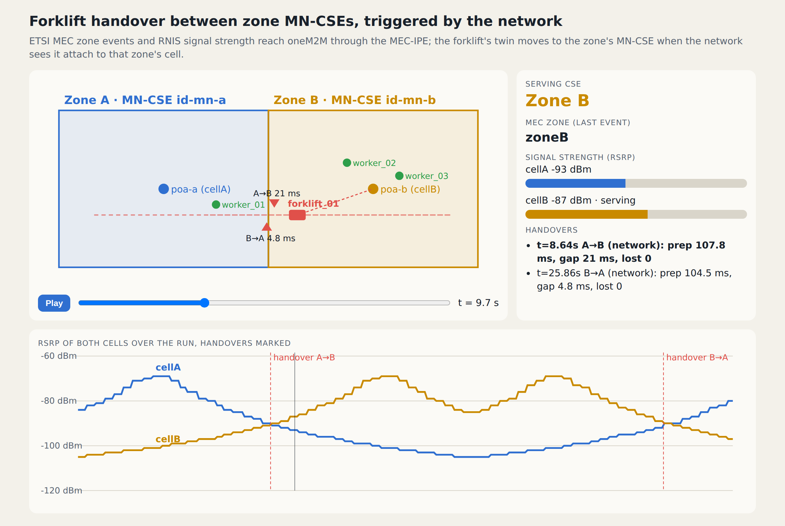
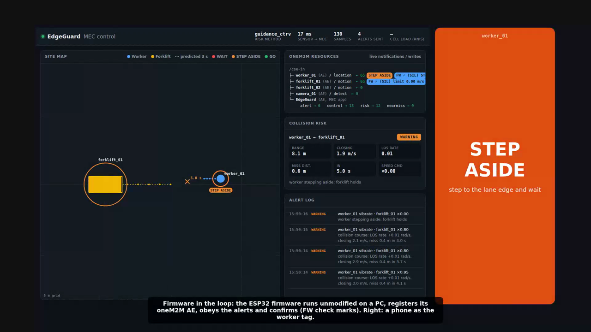

# EdgeGuard: Stop Forklift Accidents Before They Happen with oneM2M and ETSI MEC

*Predict worker–forklift collisions 1–3 seconds ahead on the network edge, tell people exactly what to do, and keep protecting them when the network fails, all built on standard oneM2M resources.*

**Team EdgeGuard (Sejong University) · 2026 oneM2M International Hackathon**


---

## Things used in this project

**Hardware components**

| Component | Qty | Role |
|---|---|---|
| ESP32 development board (ESP32-WROOM DevKit) | 2 | worker tag, forklift module |
| Qorvo DWM1000 UWB module (or an ESP32 UWB board) | 2+ | positioning, device-to-device ranging |
| Coin vibration motor + NPN transistor (2N2222) + diode (1N4148) + 1 kΩ resistor | 1 set | the tag's haptic cue |
| LEDs + 220 Ω resistors | 2 | tag WAIT light, forklift beacon |
| Small DC motor + driver (L298N or MOSFET module) | 1 | stands in for the forklift drive, so the speed limit is visible |
| Smartphone (optional) | 1 | a worker tag without any hardware (vibration, screen) |

**Software apps and online services**

- [oneM2M](https://www.onem2m.org) CSEs: [ACME CSE](https://github.com/ankraft/ACME-oneM2M-CSE) (IN-CSE and zone MN-CSEs) and [KETI Mobius](https://github.com/IoTKETI/Mobius)
- [ETSI MEC](https://www.etsi.org/technologies/multi-access-edge-computing) Location (MEC 013) and RNIS (MEC 012) on the ETSI MEC Sandbox and a self-hosted AdvantEDGE
- Python 3.11 (FastAPI, NumPy), Arduino IDE (ESP32 core 3.x, ArduinoJson), Docker Compose
- [Eclipse Mosquitto](https://mosquitto.org) (oneM2M MQTT binding over TLS), OpenSSL (demo site CA)
- Model Context Protocol (MCP) for the AI safety agent; Claude (optional) for free questions

---

## Story

### The problem: people and forklifts share the same aisles

Korea recorded **2,559 forklift accident casualties in 2021–2022** (KOSHA). One workplace injury costs about **USD 116,000** once indirect costs are included (NSC Injury Facts, OSHA 3885). Proximity alarms exist, but they have three weaknesses:

1. **They cry wolf.** A 5 m distance alarm also fires on every forklift that will pass safely. In our simulation, **85 %** of its alerts are false, and workers learn to ignore them.
2. **One buzz says "danger", not "what now".** In our first version, the remaining collisions came from workers who stopped at the buzz and then walked back into the lane before the forklift had passed.
3. **No server, no safety.** When the network or the server fails, server-based systems go silent exactly when they are needed.

### Our solution in one sentence

Tags and forklift modules publish their positions into **oneM2M**. An **ETSI MEC** application next to the CSE predicts collision courses. Each worker gets **WAIT → GO**, or **STEP ASIDE** when standing in the lane, and the forklift slows only as much as needed.

### How it works

1. **Sense:** UWB worker tags and forklift modules publish their position up to 10 times per second (2 Hz when nothing is near): as an UPDATE of their own SDT device twin on ACME, or as a contentInstance on any CSE (Mobius, and the ESP32 firmware today).
2. **Notify:** the edge CSE notifies the EdgeGuard MEC app through subscriptions. No polling and no custom broker.
3. **Predict:** Kalman tracking, a turning model for forklifts (CTRV), or the forklift's planned route when the fleet system shares it.
4. **Decide:** a **collision-course test** borrowed from missile guidance. If the bearing stays constant while the range closes (line-of-sight rate ≈ 0) and the closest point of approach is inside the safety radius, the two will meet. A forklift that will pass by never raises an alert.
5. **Cue:** an alert contentInstance goes back through oneM2M. The tag shows **WAIT** until the forklift has passed and then **GO**, or **STEP ASIDE**. The forklift module enforces the smallest speed limit that avoids contact. Each device confirms what it did in its own `status` container.

---

## oneM2M resource design

Each device is **its own AE**, so the originator is the device. The MEC app's decisions are oneM2M resources too, which means any oneM2M application can subscribe to them. The tree below shows the SDT data model on a zone MN-CSE (illustrative; the same tree runs on the IN-CSE in the single-CSE demos).

```
/cse-mn-a (zone MN-CSE on the MEC host)
├─ worker_01                AE, originator SWorker01, lbl egs:role/worker
│   ├─ tag                  flexContainer egs:wrkTg (device class "workerTag")
│   │   ├─ kinematics       egs:kinSt  posX, posY, speed, heading, sampleTime   (mni 100: history)
│   │   ├─ cue              egs:wrkCe  cueState IDLE | WAIT | ASIDE | GO
│   │   ├─ battery          cod:bat    standard oneM2M module class
│   │   └─ smd              semanticDescriptor (SAREF, RDF/Turtle)
│   ├─ relay · status       containers: D2D relay, actuator confirmations
│   └─ acp_worker_01        ACP
├─ forklift_01              AE, originator SForklift01
│   ├─ module               egs:frkMe: kinematics, speedLimit (egs:spdLt), battery, smd
│   └─ acp_forklift_01
└─ EdgeGuard                AE of the MEC app: risk · alert · control · nearmiss (mni 2000) · mec_lease
```

### A standard data model: SDT flexContainers (TS-0023 style)

Instead of opaque JSON in contentInstances, device state uses **flexContainer specializations** from our own SDT domain `org.edgeguard.safety`. The device classes `workerTag` and `forkliftModule` combine three new module classes with the **standard** `battery` module class from `org.onem2m.common`. The domain is a single file that the CSE loads ([`config/onem2m/edgeguard.fcp`](../config/onem2m/edgeguard.fcp)):

```json
{ "type": "egs:kinSt", "lname": "kinematicState", "sdttype": "moduleclass",
  "cnd":  "org.edgeguard.safety.moduleclass.kinematicState",
  "attributes": [
    { "sname": "posX",  "lname": "positionX",  "type": "float",   "car": "1" },
    { "sname": "posY",  "lname": "positionY",  "type": "float",   "car": "1" },
    { "sname": "speed", "lname": "speed",      "type": "float",   "car": "01" },
    { "sname": "smpTe", "lname": "sampleTime", "type": "integer", "car": "1" } ] }
```

With the SDT data model (ACME), a position sample is a single UPDATE of the kinematics module. The CSE keeps the history (`fcied`, `mni`) and notifies the subscribers. Mobius deployments and the current ESP32 firmware use plain contentInstances; the MEC app accepts both:

```http
PUT /cse-mn-a/forklift_01/module/kinematics
X-M2M-Origin: SForklift01
{"egs:kinSt": {"posX": 3.5, "posY": 2.1, "speed": 1.8, "headg": 0.0, "smpTe": 1791617040123}}
```

### Discoverability: labels and semantics

- **Labels:** every resource carries `egs:site/…`, `egs:role/…`, `egs:id/…`, `egs:module/…`. The MEC app finds every kinematics module with **one discovery request**, `GET /cse?fu=1&ty=28&lbl=egs:module/kinematics`. A tag that registers itself is onboarded automatically, without a device list; in CI this takes about 9 s.
- **Semantics:** each twin has a **SAREF** description in a `semanticDescriptor`. A **semantic query** answers questions like "which forklifts control their drive speed?" and returns oneM2M paths an application can subscribe to:

```sparql
PREFIX saref: <https://saref.etsi.org/core/>  PREFIX egs: <https://edgeguard.example/ns#>
SELECT ?d ?path WHERE { ?d a saref:Device ; egs:role "forklift" ;
                           saref:controlsProperty egs:DriveSpeed ; egs:resource ?path . }
```

### Security and privacy: least privilege per device

- **One ACP per device AE:** the device has full rights, the MEC app and the MEC-IPE may read, discover and subscribe, and every other device gets nothing.
- **CREATE limited by child type:** with `accessControlObjectDetails` (`chty: [23]`), the MEC app may create **subscriptions only** and cannot write data into a device's twin.
- **Checked on every commit:** CI runs 8 access checks against a real Mobius (a forged write from another device is refused) and checks on ACME that another device cannot update a twin (403).
- **Encrypted, authenticated transport:** devices use MQTT over TLS, and applications use HTTPS. In CI, plaintext HTTP and MQTT, an untrusted certificate, a wrong password, a device sending as another device, and another device reading the forklift's data are all refused (10/10).
- **Privacy by placement:** worker trajectories stay in the zone's edge CSE; only alerts, risk summaries and near-miss records (event positions, not trajectories) leave the site. Device-to-device frames are signed with an HMAC.

```json
{"m2m:acp": {"rn": "acp_forklift_01", "pv": {"acr": [
   {"acor": ["SForklift01"], "acop": 63},
   {"acor": ["SEdgeGuard", "SMecIpe"], "acop": 51, "acod": [{"chty": [23]}]} ]}}}
```

### Protocols: each link uses what fits

| Link | Protocol | Why |
|---|---|---|
| Device → CSE | oneM2M **MQTT binding over TLS**, in the firmware too (`M2M_MQTT=1`; device certificate on the mutual-TLS listener) | one open connection, no inbound port; broker password and an ACL that lets a device speak only as itself |
| MEC app ↔ CSE | Mca over **HTTPS**, subscriptions / notifications | the CSE pushes every sample to the app; the CSE certificate is checked against the site CA |
| Tags behind NAT | `<pollingChannel>` | the tag long-polls; zone alerts reach it without an inbound connection |
| Zone MN-CSE ↔ IN-CSE | **Mcc** | edge to cloud, announcement of device AEs |
| Device ↔ device | ESP-NOW + HMAC, UWB ranging | works with no access point and no CSE: the fallback when the network fails |
| MEC services | ETSI MEC REST (MEC 013, MEC 012) | brought into oneM2M by a MEC-IPE |

---

## ETSI MEC integration

- **MEC services through oneM2M:** a MEC Interworking Proxy Entity (MEC-IPE) polls the **Location** and **RNIS** APIs and writes new values as oneM2M resources (`location/<ue>`, `rnis/<cell>`). The MEC app subscribes to MEC data exactly as it subscribes to a device. Location supplies positions for people without a UWB fix, and RNIS cell load sets the reporting rate and the alert priority.
- **Deployment:** the MEC app runs as a Docker container next to the CSE on the MEC host, as an active-standby pair (takeover in **0.73 s**). It ran live against the public **ETSI MEC Sandbox** (try-mec.etsi.org) and in a custom warehouse scenario on a self-hosted **AdvantEDGE** (70 alerts in 2 minutes).
- **Event-driven and bidirectional:** a second MEC-IPE subscribes to MEC 013 **zone events** and MEC 012 **per-UE measurement reports** (RSRP / RSRQ). It writes them into oneM2M as SDT twins (`egs:mecUe` with `egs:ueLoc` and `egs:rdLnk`), and it executes MEC requests that oneM2M applications post into `MEC-IPE/requests` (zone_subscribe, radio_subscribe, location, unsubscribe). Zone event → oneM2M resource: median 15–45 ms.
- **Zone broadcast:** one oneM2M `<group>` per zone. A DANGER alert is **one request** to `<group>/fopt`, and the CSE creates it in the inbox of every tag in that zone (p50 8–19 ms including the tag's polling channel).
- **Latency:** the median alert latency on the edge is **25 ms**, against 85 ms for a cloud-only path (measured with an injected 25 ms one-way WAN delay).

---

## Service continuity: CSE handover between MEC zones

A large warehouse has several zones, each with its own MEC host and MN-CSE. When a forklift drives from zone A to zone B, its oneM2M presence moves with it, **make-before-break** ([`edgeguard/handover.py`](../edgeguard/handover.py)):

1. **Trigger:** the forklift's position is 1 m inside zone B (hysteresis against ping-pong), or the serving CSE stops answering (availability).
2. **Prepare in the background** while samples keep flowing to zone A:
   - state: the module values (speed limit, kinematics, battery) are read from the source and restored on the target
   - security: the AE, twin and ACP are rebuilt with the same rules
   - subscriptions: every subscription on the twin is re-created with the same notification URIs. This works because subscribers attach the device's ACP to their subscription, which lets the device read and carry it.
   - announcement: the new AE is announced to the IN-CSE, whose AEAnnc `lnk` points at the serving CSE
3. **Switch:** the next sample goes to zone B.
4. **Home record:** `<IN-CSE>/<device>/serving` is updated, so applications can resolve or subscribe to the device's current CSE.
5. **Release:** the AE on zone A is deleted after a short grace period.

**Measured (CI, every commit):**

| Handover | Prepared in | Service interruption | Samples lost |
|---|---|---|---|
| Location A → B | ≈ 115–140 ms (in the background) | **3–11 ms** | **0** |
| Availability: zone B's CSE killed → back to A | ≈ 80 ms after detection | ≈ 306 ms | 3 (the detection window) |

The subscribed application never re-subscribed. It kept receiving notifications, now sent by zone B's CSE (`/id-mn-b`).

**Triggered by the network.** In ESTIMED terms, the trigger authority can also be the MEC network. The MEC platform sees the forklift attach to zone B's small cell and emits `ENTERING_AREA_EVENT zoneB`. The MEC-IPE writes the event into oneM2M, and the forklift, subscribed to it, starts the handover. In the CI run (A → B → A at 4 m/s), interruption was 1.5–8 ms and no sample was lost. At the boundary, the RSRP of both cells crosses over at about −90 dBm.



---

## When the network fails: graceful degradation

If a device hears no heartbeat from the MEC app for 2 s, it switches to local decisions: UWB ranging between devices, direct state exchange over ESP-NOW (HMAC-signed), and alert relay to neighbours in coverage holes. It stops only when nothing else is known.

| Condition | Collisions | Forklift throughput |
|---|---|---|
| Total network outage (180 encounters that would collide) | **2** (v0.7 hold-then-stop: 180) | 57 % (stop-everything approach: 18 %) |
| Worker or forklift in a coverage hole | **0 / 0** (was 16 / 19) | — |

---

## Federated learning across sites (oneM2M TR-0084)

Worker trajectories are personal data. To learn how people really walk (decelerating into stops and turns, which constant velocity misses), each site trains a small worker-motion model on its own data, and **only weights travel through oneM2M** ([`edgeguard/fl.py`](../edgeguard/fl.py)):

- **Coordinator (IN-AE):** a `task` flexContainer (`egs:flTsk`: model, rounds, clients per round, quorum, timeout, status, model version), a `rounds` container (selection per round) and a `models` container (every version with its parent and participants: model lineage).
- **Clients (one AE per site):** a `participant` flexContainer (`egs:flPrt`: sample count, availability, compute score, last round) and an `updates` container.
- **Dynamic selection:** participants are found by label. The coordinator picks available clients with enough data, preferring those that waited longest. If a round reaches its quorum before the timeout, it is aggregated with FedAvg.

In the CI run, Incheon's MEC host fails in the middle of round 3, and the round is still aggregated from the other two sites. Daejeon registers before round 4 and is selected immediately.

| 2 s prediction error (mean over 4 sites) | |
|---|---|
| Constant velocity (what the risk engine assumed) | 0.604 m |
| Each site training alone | 0.521 m |
| **Federated global model** | **0.486 m** |

**Aggregation is not delivery.** Each site's model manager subscribes to the model repository and handles every new version in three steps:
1. **Canary:** the version is evaluated on the site's own held-out data and must beat the active model.
2. **Activate:** it is activated in the risk engine (`guidance_fl`).
3. **Monitor:** the previous version is shadow-evaluated on live windows, and the manager rolls back if it wins three times in a row.

In CI, an untrained v0 and a corrupted v2 are rejected, and a Busan-specialised v3 is activated. After a layout change, v3 is rolled back to the global v1. Each step is recorded in `egs:mdlDp`.

*The study ran on ACME. The design follows the ESTIMED proof of concept and is meant to run on the ESTIMED VM.*

---

## Swarm and orchestration (TR-0077 7.4 and 7.1)

**Swarm.** Forklifts in a zone form a swarm: a `<group>` of their `plan` containers. Each forklift publishes its route through the intersections with arrival times and reads every member's plan with one request (`<group>/fopt/la`, ≈ 6 ms). It then computes the same conflict-free schedule as everyone else: loaded forklifts first, then the earliest arrival, then a 4 s headway at shared intersections. No coordinator is needed, and every participant keeps local authority. In the demo, conflicts drop from 4 to 0, at 14.5 s of total delay compared with 23.5 s for braking at each intersection.

**Orchestration.** MEC hosts register themselves (`egs:mecHs`: zone, free CPU and memory, RTT, lifecycle API, a one-second heartbeat). An operator deploys EdgeGuard by creating a single `egs:depIn` intent, for example "risk engine, zone A, 2 CPU, ≤ 10 ms". The orchestrator then:
1. discovers hosts by label and selects one against the constraints
2. deploys through the host's lifecycle API
3. waits for the instance to register its own AE
4. provisions it by extending the device ACPs and writing its configuration

The engine runs ≈ 0.75 s after the intent. When the zone A host crashes, the engine is running again on the second zone A host ≈ 2.3–2.7 s later, and the old instance's access is revoked.

See [docs/estimed-mapping.md](estimed-mapping.md) for how each feature maps to TR-0077 clause 7 and the ESTIMED deployment continuum (EdgeGuard is option C per zone, with an IN-CSE in the cloud).

---

## AI safety agent with MCP

A safety manager wants a shift report, not raw resources. Our agent ([`agent/`](../agent/)) talks to **four MCP servers**: one oneM2M server per CSE (the IN-CSE and both zone MN-CSEs) and one for ETSI MEC. It runs a multi-step workflow:

1. Read its own state from oneM2M, so only new near misses are processed.
2. Build the device inventory with SAREF semantic queries on every CSE.
3. Find near-miss hotspots and classify them: blind corner, unalerted, fast traffic, or crossing.
4. Add MEC context: how many people are near each hotspot right now (Location) and the radio load (RNIS).
5. For every forklift involved, look up its **serving CSE** in the home record and route the query to that zone's MCP server for the live speed limit.
6. Validate the totals and check that the data did not change mid-run, then persist the report, the cursor and a step log in oneM2M.

If a CSE is down, the agent writes a **partial** report, records the error, and keeps the cursor so those records are read again on the next run. Its writes are limited to its own AE (a server-side guardrail), and its oneM2M identity is still bound by the ACPs.

Sample recommendation from the CI run:

> (12, 4) m, 9 near misses: Blind corner: add the rack to the site map / install a convex mirror - 3 people within 6 m right now
> (-7, 0) m, 6 near misses: Fast forklift traffic: declare a speed-limited zone - forklift_02 currently without a speed limit - 1 person within 6 m right now

---

## Hardware build

| Board | Pin | Connection |
|---|---|---|
| Tag | GPIO 25 | 1 kΩ → transistor base; vibration motor on the collector (other end 3.3 V); diode across the motor |
| Tag | GPIO 2 | 220 Ω → LED → GND (WAIT light) |
| Forklift | GPIO 27 | motor driver PWM / EN; driver powered from a power bank |
| Forklift | GPIO 26 | 220 Ω → LED → GND (beacon) |

*Status: the board kit and wiring are ready and the board demo is scheduled before the final; the CI evidence today is firmware-in-the-loop.* The firmware ([`firmware/`](../firmware/)) registers the device's own AE at boot and receives alerts as oneM2M notifications. It drives the outputs and writes confirmations to `<device>/status`, which appear on the dashboard as **HW ✓**. **Firmware-in-the-loop:** the same sketches compile unmodified for a PC, and CI runs them against a real CSE on every commit (6 of 6 checks). A phone can act as the tag: open `http://<MEC host>:9090/tag?worker=worker_01`.



---

## Results (closed-loop simulation)

**Against our own v1.0 (vibration-only alert, same simulator):**

| | v1.0 | EdgeGuard |
|---|---|---|
| Collisions, many-to-many site (8 workers, 4 forklifts, 750 conflicts) | 100 | **4 (−96 %)** |
| Forklift throughput on that site | 61.7 % | **86.0 %** |
| Collisions in 1,207 one-to-one conflicts | 145 | **1** |

**Against a 5 m proximity alarm:**

| | 5 m alarm | EdgeGuard |
|---|---|---|
| Detected ≥ 1 s before contact | 76 % | **100 %**, median lead time 2.4 s |
| False alarm rate | 85 % | **30 %** |

Worker behaviour is modelled, so we report sensitivity: at 85 / 70 / 50 % WAIT compliance, collisions are 12 / 27 / 42 of 1,207 (v1.0: 145).

---

## Why oneM2M, and why we would keep using it

- **A hub, not a database:** subscriptions replaced the broker and polling code we would otherwise have written.
- **Open by design:** alerts and near misses are standard resources. A WMS, a reporting tool or a camera vendor can subscribe without any integration work.
- **Security comes built in:** per-device ACPs with child-type restrictions gave us least privilege without writing an authentication layer.
- **One model from the device to the cloud:** SDT flexContainers, labels and SAREF semantics make devices discoverable (on ACME), and the same application code runs on Mobius and ACME.
- **Mobility as a service feature:** announcement, home records and portable subscriptions let a device change CSEs while applications keep receiving data.

Along the way we found and documented **7 interoperability issues** between CSEs, including a Content-Type parsing fix for ACME ([interoperability notes](interop-notes.md)).

---

## Try it yourself

```bash
git clone https://github.com/ljw22112/Edgeguard && cd Edgeguard
pip install -r requirements.txt
scripts/acme.sh start in mn-a mn-b              # IN-CSE + two zone MN-CSEs with the EdgeGuard SDT domain
scripts/run_live_demo.sh                        # live demo, dashboard at http://localhost:9090/
python tools/handover_demo.py --failover        # CSE handover between zones
python tools/fl_demo.py                         # federated learning through oneM2M
python tools/agent_demo.py                      # AI safety agent over MCP
python tools/mobility_demo.py                   # MEC zone events -> network-triggered handover, signal strength
python tools/orchestration_demo.py              # deploy by intent across MEC hosts
python tools/swarm_demo.py                      # forklift swarm
python tools/model_delivery_demo.py             # canary, activate, roll back federated models
python tools/zone_demo.py                       # group fan-out + pollingChannel
python tools/sil_run.py                         # firmware-in-the-loop
```

Full Docker stack with Mobius: `cd deploy && docker compose --profile demo up -d`.

## Links

- Article on hackster.io: https://www.hackster.io/ahind012/edgeguard-stop-forklift-accidents-before-they-happen-e07309
- Code: https://github.com/ljw22112/Edgeguard
- Video (2 min 34 s): https://youtu.be/P2JI5ZG6PIg
- Demo videos in the repository: `results/edgeguard_final.mp4`, `results/edgeguard_demo_v1.3.mp4`, `results/edgeguard_firmware_in_the_loop.mp4`
- oneM2M: https://www.onem2m.org · [oneM2M specifications](https://www.onem2m.org/technical/published-specifications) (TS-0001 architecture, TS-0004 protocols, TS-0023 SDT)
- ACME CSE: https://github.com/ankraft/ACME-oneM2M-CSE · KETI Mobius: https://github.com/IoTKETI/Mobius
- ETSI MEC: https://www.etsi.org/technologies/multi-access-edge-computing · ETSI MEC Sandbox: https://try-mec.etsi.org
