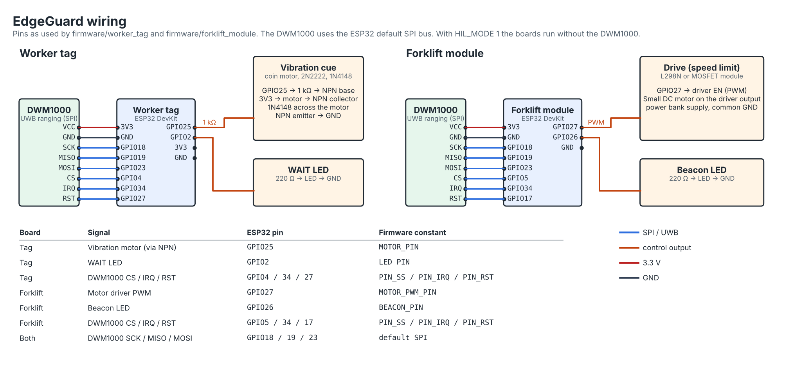
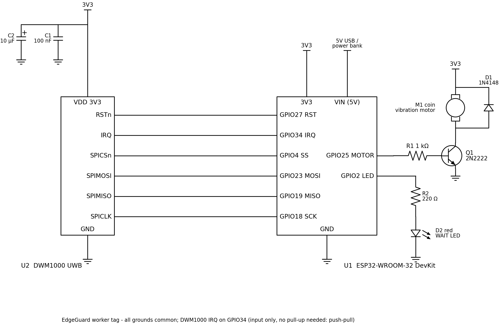
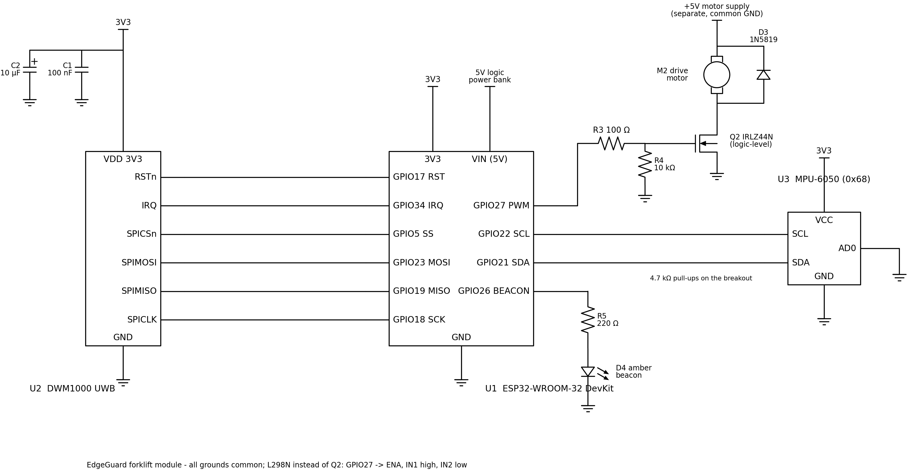

# Hardware demo (firmware-in-the-loop · phone tag · boards)

[← README](../README.md) · [한국어](ko/hardware-demo.md)

We show real operation in three stages. The first two work right now with no parts; only the third needs boards.

| Stage | What is real | What you need | Status |
|---|---|---|---|
| ① Firmware-in-the-loop (SIL) | **The exact firmware code that runs on the boards** registers the oneM2M AE, receives subscription notifications, drives outputs and writes acknowledgements | 1 PC | **Tested automatically in CI on every commit (6/6)** |
| ② Phone tag | A real phone acts as the worker tag with vibration, sound and screen (WAIT / STEP ASIDE / GO) | 1 phone | Verified working |
| ③ ESP32 boards | The same firmware as ① physically drives a vibration motor, LEDs and a DC motor | Parts for about KRW 50,000 (≈ USD 35) | Kit ready (team demo planned) |


## ① Firmware-in-the-loop

The `firmware/worker_tag` and `firmware/forklift_module` sketches are compiled for the PC **without changing a single line**.
The Arduino API is provided by `tests/firmware/sil/sil_core.cpp`: the HTTP client and server run over real TCP,
and values written to the vibration motor, LED, motor PWM and beacon pins are logged with timestamps. UWB and IMU are left out as in HIL mode, and positions are supplied by `devices/live_devices.py`.

```bash
python tools/sil_run.py                       # crossing (needs local ACME: scripts/run_local_demo.sh installs and runs it)
python tools/sil_run.py --scene head_on       # STEP ASIDE → WAIT → GO, forklift stops then restarts
python tools/sil_run.py --scene head_on --record results/edgeguard_firmware_in_the_loop.mp4   # record dashboard + phone screen
```

| Automated checks (CI on every commit, both crossing and head_on) | Latest result (crossing) |
|---|---|
| Worker tag firmware: LED on during WAIT (≥ 2 s) · vibration pulses | LED 4.3 s, repeated vibration pulses |
| Worker tag firmware: GO after the forklift passes (LED off) | Pass |
| Forklift firmware: motor PWM reduced to the speed limit → restored after release | PWM 180 → 158 → 180 (2.2 m/s limit) |
| Forklift firmware: beacon blinks during an alert | Pass |
| MEC app receives the firmware's acknowledgement (`<device AE>/status`) via subscription | `WAIT`, `limit 2.20 m/s` |

Output: `results/sil_run.json` (timeline of every output change). In head_on, the firmware acknowledges `STEP ASIDE` and `limit 0.00 m/s` (stop).
The dashboard's oneM2M panel shows firmware acknowledgements as **FW ✓ (SIL)**.

## ② Phone tag

The MEC app serves a tag screen for phones. Open it on a phone on the same Wi-Fi and tap **Start tag**.

```
http://<MEC app address>:9090/tag?worker=worker_01
```

- Same rules as the firmware (`worker_cue.h`): WAIT (red, long vibration + short vibration every second) · STEP ASIDE (orange, longer vibration) · GO (green, two short vibrations)
- Every screen change sends an acknowledgement to the MEC app, shown as **PHONE ✓** on the dashboard
- Android Chrome vibrates; iPhone uses sound and screen instead of vibration
- Open it during the live demo (`scripts/run_live_demo.sh`) and the phone immediately becomes worker_01's tag. Film it in your hand to get a "real vibration" video.

## ③ ESP32 boards (hardware-in-the-loop)

Two ESP32 boards physically act as the **worker tag (worker_01)** and the **forklift module (forklift_01)**.
Instead of UWB positioning, positions come from `devices/live_devices.py`; the boards do exactly what real devices do.

| What actually happens | What the simulation handles |
|---|---|
| On boot, the board registers its own oneM2M AE and containers (`registerAE`) | Worker and forklift positions and movement |
| Receives MEC app alerts as oneM2M subscription notifications (`/alert`) | |
| Vibration motor · LED (WAIT / STEP ASIDE / GO), motor slowdown · beacon | |
| Writes acknowledgements to its own AE's `status` → **HW ✓** on the dashboard | |

Adding UWB boards (DW1000) makes positioning physical too, with the same firmware (`HIL_MODE 0`).

## Parts list (about KRW 50,000 (≈ USD 35))

| Part | Qty | Purpose |
|---|---|---|
| ESP32 dev board (e.g. ESP32-WROOM DevKit) | 2 | Tag · forklift module |
| Coin vibration motor + NPN transistor (2N2222) + diode (1N4148) + 1 kΩ resistor | 1 set | Tag vibration |
| LED + 220 Ω resistor | 2 | Tag WAIT indicator, forklift beacon |
| Small DC motor + logic-level MOSFET (IRLZ44N), 100 Ω + 10 kΩ, Schottky diode (1N5819) - or an L298N | 1 | Forklift drive (attach a wheel or fan so the slowdown is visible) |
| DWM1000 UWB module + 100 nF / 10 µF capacitors | 2 | Positioning, D2D ranging |
| MPU-6050 breakout | 1 | Forklift yaw rate |
| Breadboard · jumper wires · 2 power banks | — | |

## Wiring



The diagram is drawn from the firmware pin constants by `tools/draw_wiring.py`.

### Schematics

Worker tag (ESP32 + DWM1000 UWB + vibration motor + WAIT LED):



Forklift module (ESP32 + DWM1000 UWB + MPU-6050 IMU + drive motor + beacon):



Drawn from the firmware pin constants by [`tools/draw_schematic.py`](../tools/draw_schematic.py) (SVG next to the PNG). Notes:
- The DWM1000 sits on the ESP32's VSPI bus (SCK 18, MISO 19, MOSI 23); IRQ goes to GPIO 34, an input-only pin. Decouple its 3.3 V pin with 100 nF + 10 µF close to the module.
- The vibration motor is switched low-side by a 2N2222 (1 kΩ base resistor) with a 1N4148 flyback diode, cathode to 3.3 V.
- The drive motor runs from its own 5 V supply through a logic-level MOSFET (IRLZ44N, 100 Ω gate resistor, 10 kΩ pull-down so the motor stays off while the ESP32 boots) with a 1N5819 flyback diode. All grounds are common. With an L298N instead: GPIO 27 to ENA, IN1 high, IN2 low.
- The MPU-6050 breakout has its own I2C pull-ups; AD0 low gives address 0x68 as the firmware expects.

| Board | Pin | Connection |
|---|---|---|
| Tag | GPIO 25 (`MOTOR_PIN`) | 1 kΩ → transistor base; vibration motor on the collector (other side to 3.3 V); diode across the motor |
| Tag | GPIO 2 (`LED_PIN`) | 220 Ω → LED → GND (most boards have a built-in LED) |
| Forklift | GPIO 27 (`MOTOR_PWM_PIN`) | Motor driver PWM/EN input; driver powered from a power bank |
| Forklift | GPIO 26 (`BEACON_PIN`) | 220 Ω → LED → GND |

## Flashing the firmware

1. In the Arduino IDE, install the ESP32 board package (3.x) and the libraries **ArduinoJson** and **arduino-dw1000**.
2. In `firmware/worker_tag/worker_tag.ino` and `firmware/forklift_module/forklift_module.ino`:
   - `#define HIL_MODE 0` → **`1`**
   - `WIFI_SSID` · `WIFI_PASS`: the same Wi-Fi as the laptop
   - `CSE_URL` → `http://<laptop IP>:8080/cse-in` (local ACME), or `http://<IP>:7579/Mobius` for Mobius
3. After uploading, check the serial monitor (115200) for `oneM2M AE worker_01: ok` and the board's **IP**.

## Running

```bash
# 1) Put both boards' IPs in config/hw-demo.yaml (alert_subscribers)
# 2) Start local ACME (scripts/run_local_demo.sh installs and runs it the first time), then
HW=1 scripts/run_live_demo.sh          # MEC app + resources + reactive virtual positions (scene loops)
# Dashboard http://localhost:9090/  — "HW ✓" next to worker_01 / forklift_01 in the oneM2M panel
```

## Checks (video shooting checklist)

| # | Scene | Expected behaviour | Result |
|---|---|---|---|
| 1 | Boot | Serial shows `oneM2M AE ... ok`; `worker_01` · `forklift_01` AEs created in ACME/Mobius | |
| 2 | crossing | Tag: long vibration → LED on + short vibration every second (WAIT) → two short vibrations after the forklift passes (GO), LED off | |
| 3 | crossing | Forklift: beacon blinks; motor slows to the passing speed, then returns to normal speed after release | |
| 4 | head_on | Tag: STEP ASIDE (long vibration) → WAIT → GO / Forklift: motor stops, then restarts | |
| 5 | Dashboard | Map badges (WAIT/STEP ASIDE/GO) and the **HW ✓ status** in the oneM2M panel match the board behaviour | |
| 6 | Failure | Stop the MEC app (`scripts/mec.sh stop`) during an alert (while the forklift is slowed) → forklift motor stops after 2 s (silence failsafe); tag WAIT clears itself after 2.5 s | |
| 7 | Access control | `python3 deploy/check_acl.py http://localhost:8080/cse-in` → 8/8 | |

Filling in the Result column and keeping the videos (phone footage + screen recording) together provides the evidence that it "really works".
