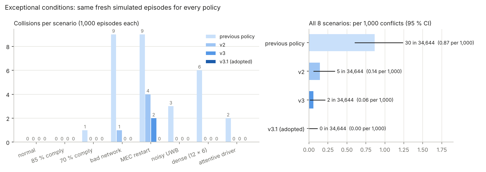

# 일반 상황과 예외 상황

[← README](../../README.ko.md) · [English](../robustness.md) · [현장 방식 비교](site-compare.md)

안전 시스템은 나쁜 날에 평가받습니다. [`sim/robust_eval.py`](../../sim/robust_eval.py)는 다대다 현장(작업자 8명 · 지게차 4대, 25초)을 8가지 조건에서 돌립니다. 모든 조건이 같은 에피소드를 쓰고 조건만 바뀝니다.

| 시나리오 | 바뀌는 것 |
|---|---|
| 일반 | 무작위 네트워크(40~220 ms, 손실 최대 20 % / 10 %), UWB 오차 0.1~0.35 m |
| 준수율 85 % / 70 % | 작업자가 경보의 15 % / 30 %를 무시(진동에 약 2초 멈췄다가 다시 걸음) |
| 통신 불량 | 지연 300~600 ms, 상향 손실 20~40 %, 하향 손실 15~30 % |
| MEC 재시작 | 무작위 시점에 MEC 앱이 2.5초 멈췄다가 경보 상태 **없이** 복귀 |
| 측위 오차 ↑ | 위치 오차 0.35~0.6 m |
| 혼잡 | 작업자 12명 · 지게차 6대 |
| 주의하는 운전자 | 운전자가 바로 앞 사람을 보고 제동(반응 1초) |

## 시험 시드 결과 (5000번부터, 시나리오당 150 에피소드), 강건 정책 v1

| 시나리오 | 충돌: 이전 / **강건** | 1.5 m 미만 근접 통과 | 지게차 처리량: 이전 / **강건** |
|---|---|---|---|
| 일반 | 0 / **0** | 0 / 0 | 91.1 % / **96.6 %** |
| 준수율 85 % | 0 / **0** | 2 / 2 | 86.1 % / **94.7 %** |
| 준수율 70 % | 0 / **0** | 3 / 2 | 82.2 % / **90.8 %** |
| 통신 불량 | 0 / **0** | 15 / 6 | 82.9 % / **90.8 %** |
| MEC 재시작 | **3** / **0** | 14 / 8 | 85.9 % / **93.8 %** |
| 측위 오차 ↑ | 0 / **1** | 1 / 4 | 82.7 % / **90.6 %** |
| 혼잡 | 0 / **0** | 6 / 2 | 87.2 % / **95.1 %** |
| 주의하는 운전자 | 0 / **0** | 2 / 0 | 90.2 % / **95.4 %** |
| **전체 1,200 에피소드** | **3 / 1** | **43 / 24** | |

두 정책 모두 같은 단말(D2D 대체와 긴급제동, 아래)로 돌렸습니다. "이전"은 지게차 우선 도입 전의 학습 정책입니다([`results/policy_previous.json`](../../results/policy_previous.json)). 강건 정책이 모든 처리량 항목과 전체 충돌 · 근접 통과에서 낫습니다. 다만 **0.35~0.6 m UWB 오차에서 1,200 에피소드 중 충돌 1건**이 남았습니다(한계 참고).

## 강건 정책 v2 (글라이드), 두 시험 세트

v2는 글라이드와, 작업자가 경로를 벗어나면 정지 지점을 바로 해제하는 기능을 더했습니다([site-compare.md](site-compare.md)). 강건 학습으로 미세 조정하고 검증 2,000 에피소드(시드 13,000번 · 15,000번부터)에서 충돌이 없는 후보를 골랐습니다. 위 시험 시드와, 새로운 두 번째 시험 세트(17,000번부터)에서 각각 8 시나리오 × 150 에피소드로 시험했습니다.

| | 충돌 (5000번~ / 17000번~) | 1.5 m 미만 근접 통과 | 8 시나리오 평균 처리량 |
|---|---|---|---|
| 이전 정책 | 3 / 5 | 43 / 29 | 86.0 % / 86.6 % |
| 강건 v1 | 1 / 1 | 24 / 27 | 93.5 % / 94.1 % |
| **강건 v2** | **2 / 0** | 35 / 29 | **94.1 % / 94.4 %** |

안전은 v1 수준을 유지했고(스트레스 2,400 에피소드 중 각각 충돌 2건, 이전 정책 8건, 일반 시나리오에서는 0건), 처리량은 0.3~0.6%p 높습니다. 첫 시험 세트에서는 v2의 근접 통과가 다소 많았습니다. v2의 충돌 2건은 MEC 재시작 뒤였습니다. 결과: [`results/robust_eval.json`](../../results/robust_eval.json), [`results/robust_eval_test2.json`](../../results/robust_eval_test2.json).

## 대규모 시험: 정책당 새 에피소드 8,000개, 신뢰구간 포함

1,200 에피소드에서 0~5건의 충돌로는 정책을 구별할 수 없습니다. [`sim/large_eval.py`](../../sim/large_eval.py)는 모든 정책을 **시나리오마다 같은 새 에피소드 1,000개**(시드 23,000번부터, 어떤 정책의 학습 · 선택 · 조정에도 쓰지 않음)로 돌립니다. 정책당 8,000 에피소드, 충돌 상황 34,644건입니다. 구간: 충돌 상황 1,000건당 충돌은 Wilson 95 %, 처리량은 부트스트랩 95 %.

| 시나리오 | 충돌: 이전 / v2 / **v3** | 처리량: 이전 / v2 / **v3** |
|---|---|---|
| 일반 | 0 / 0 / **0** | 91.6 % / 97.3 % / **97.3 %** |
| 준수율 85 % | 0 / 0 / **0** | 87.4 % / 94.7 % / **94.7 %** |
| 준수율 70 % | 1 / 0 / **0** | 83.0 % / 90.6 % / **90.7 %** |
| 통신 불량 | 9 / 1 / **0** | 83.4 % / 91.0 % / **91.2 %** |
| MEC 재시작 | 9 / 4 / **2** | 87.6 % / 94.6 % / **94.6 %** |
| 측위 오차 큼 | 3 / 0 / **0** | 83.2 % / 93.1 % / **93.1 %** |
| 밀집 (작업자 12, 지게차 6) | 6 / 0 / **0** | 87.4 % / 95.1 % / **95.1 %** |
| 주의 깊은 운전자 | 2 / 0 / **0** | 90.7 % / 95.5 % / **95.5 %** |
| **충돌 상황 34,644건 전체** | **30 / 5 / 2** | |
| 1,000건당 (95 % 신뢰구간) | 0.87 [0.61~1.24] / 0.14 [0.06~0.34] / **0.06 [0.02~0.21]** | |

- **v3 대 이전 정책: 충돌 93 % 감소**(구간이 겹치지 않음), **모든 시나리오에서 처리량 +4.8~+9.9 %p**.
- **v3 대 v2:** 충돌 5건 → 2건, 처리량은 같음(±0.2 %p 이내). 구간이 겹치므로 "적어도 같은 만큼 안전"이며, 두 건은 v3가 겨냥한 MEC 재시작 시나리오에 있습니다(4 → 2).
- 8개 중 7개 시나리오는 각 1,000 에피소드에서 충돌 0이며, 95 % 상한은 충돌 상황 1,000건당 약 1건(밀집 현장 0.46)입니다.

에피소드별 원자료: [`results/large_eval.json`](../../results/large_eval.json), 요약 [`results/large_eval_report.txt`](../../results/large_eval_report.txt).

## 실패 원인과 수정 (파이썬 기준 구현과 펌웨어)

시나리오 세트의 충돌을 하나씩 추적해 찾고, 고치고, 새 시드로 다시 확인했습니다.

| 찾은 문제 | 수정 |
|---|---|
| 정지 지점(지게차가 그 앞에서 멈춰야 하는 위치)이 위치 오차로 조금씩 멀어졌고, DANGER일 때는 빠졌음 | 한 조우 안에서 정지 지점은 가까워지기만 하고, 작업자가 1 m 넘게 움직였을 때만 멀어짐. DANGER와 "작업자 먼저"에서도 유지 |
| 한 지게차를 피하라는 STEP ASIDE가 작업자를 다른 지게차 쪽, 또는 그 지게차의 진행 경로를 가로질러 보냄 | 비켜서는 곳은 모든 지게차에서 떨어져 있어야 하고, 진행 경로를 가로지르지 않음 |
| MEC 재시작 뒤 태그 WAIT가 2.5초 무응답으로 풀린 사이 지게차가 지나감. 재시작한 앱이 경보를 다시 올리는 데 시간이 걸림 | 태그의 D2D 규칙이 가까운 지게차를 보면 MEC가 조용해도 WAIT 유지(최대 20초). 침묵이 끝난 뒤 1.5초 동안 D2D 규칙 유지 |
| 통신 불량: 지게차로 가는 속도 계획 · 정지 지점 유실 | 지게차가 적용 중인 계획을 매 위치 샘플에 보고하고, `ack_s` 안에 보고되지 않은 계획은 MEC 앱이 다시 보냄 |
| 늦게 도착한 "clear"가 더 새로운 "raise"를 덮어씀(지터) | 태그와 지게차 모듈이 같은 쌍의 마지막 적용 메시지보다 오래된 메시지는 버림(`mec_tx_ts`) |
| 통로로 걸어 들어오는 작업자의 정지 지점이 그가 서 있는 위치였음 | ... 통로 중앙 앞으로(`env_walk_in`) |
| 위 어느 것도 못 막는 드문 경우 | **상시 D2D 긴급제동**: 단말 간 상태 방송만으로 1.5초 안에 1.3 m 이내로 다가오는 충돌 경로의 작업자가 있으면 지게차를 세움. MEC 앱과 네트워크가 동작하든 말든 |

## 정책 v3: 태그가 GO를 스스로 확인

아래 대규모 시험에서 v2의 약점이 드러났습니다. 8,000 에피소드 중 충돌 5건 가운데 4건이 MEC 재시작 직후였습니다. 이 충돌들(과 밀집 현장 1건)을 추적해 세 가지 원인을 찾았습니다.

| 발견 | 변경 (v3) |
|---|---|
| 재시작한 MEC 앱이 자신이 준 WAIT를 잃음. 아무도 GO를 확인하지 않아 WAIT가 2.5초 응답 없이 끝났고, 작업자가 아직 다가오던 트럭 쪽으로 걸어감 | **태그 GO 확인**(`tag_walk_check`): WAIT가 스스로 끝나기 전에 태그가 D2D 상태 방송만으로, WAIT 전 속도와 방향으로 다시 걸으면 트럭과 충돌 경로가 되는지 확인. 그렇다면 WAIT 유지(최대 20초) |
| 밀집 현장에서도 같은 일: 한 트럭 때문에 기다리던 작업자의 WAIT가 끝났는데, 정지 범위로 조용히 지나가던 두 번째 트럭(기다리는 작업자를 믿고 통과)이 4 m 앞에 있었음 | 같은 확인을, 응답 없이 끝나는 모든 WAIT에 적용 |
| 재시작 후 다시 쌓은 경보 상태가, 트럭이 작업자 옆에서 막 출발하는 순간 쌍을 해제(GO)함 | MEC 침묵 이전에 받은 WAIT("고아" WAIT)의 해제 · GO에도 확인 적용 |
| 경로 안의 사람 앞에 서 있는 트럭의 계획이 해제됨("지금 속도보다 느리게"는 0 m/s에서 제한이 아님) → 사람 쪽으로 기어감 | 경로 안의 사람 앞에 서 있는 트럭은 계속 정지(`env_keep_stop`) |

걷는 속도는 작업자가 분명히 걸을 때(0.6 m/s 초과)만 기록합니다(0.3 m/s에서는 서 있는 작업자의 속도 잡음이 덮어씀). 파이썬 기준 구현 [`edgeguard/device_policy.py`](../../edgeguard/device_policy.py)(`truck_near_if_walk`, `orphaned`), 펌웨어 [`firmware/common/device_policy.h`](../../firmware/common/device_policy.h), [`worker_cue.h`](../../firmware/common/worker_cue.h), 동일 결과는 [`tests/test_device_policy.py`](../../tests/test_device_policy.py).

개발 시드 62,000번부터 변형 비교(8 시나리오 × 150 에피소드, 시나리오 평균):

| | 충돌 | 근접 통과 | 평균 처리량 | 작업자 손실 시간 |
|---|---|---|---|---|
| v2 | 2 | 23 | 95.0 % | 2.56초 |
| 고아 WAIT에만 GO 확인 (+ 정지 유지) | 1 | 16 | 95.0 % | 2.56초 |
| 모든 GO에 확인 (MEC 앱의 GO 포함) | 0 | 16 | 95.1 % | **3.19초** |
| WAIT가 끝날 때 확인 | 0 | 15 | 95.1 % | 2.57초 |
| **v3: ... + 고아 WAIT의 해제** | **0** | **15** | **95.0 %** | **2.58초** |

모든 GO를 확인하면 똑같이 안전하지만 작업자가 25 % 더 기다립니다. MEC 앱의 GO 확인이 이미 아는 트럭을 다루고, 태그는 근처를 지나가기만 하는 트럭에도 붙잡기 때문입니다. WAIT가 끝날 때만 확인하는 변형은 검증 시드 11,000번부터에서 충돌 1건(재시작 후 해제)이 있었고, v3는 0건이었습니다(8 × 150 에피소드, 평균 처리량 94.7 %, 작업자 시간 2.56초). 원본 출력: [`results/tag_go_check_dev_val.txt`](../../results/tag_go_check_dev_val.txt).

검증 후 기각(옵션으로 남기고 끔): 0.6초 서 있은 뒤에만 STEP ASIDE(`aside_still_s`, 충돌 증가 · 처리량 감소), r_safe 안의 작업자에게만 STEP ASIDE(`aside_reach`, 측위 오차 사례는 고쳤지만 다른 곳에서 3건 증가), 정지 범위 경보에서 걷는 작업자 진동(`env_buzz_walker`)과 최악 방향 GO 검사(`go_unknown_worst`)는 효과 없음.

## v2 위에 시험했지만 채택하지 않은 것 (개발 시드 60000번부터, 8 시나리오 × 100 에피소드)

| | 충돌 | 일반 처리량 | 작업자 손실 시간(일반) | 에피소드당 경보(일반) |
|---|---|---|---|---|
| v2 | 0 | 98.4 % | 1.99초 | 7.1 |
| + 그린 웨이브(지게차를 미리 살짝 감속해 작업자가 건넌 뒤 도착) | 1 | 96.9 % | 2.21초 | 6.1 |
| + 그린 웨이브, 완만하게(최대 20 % 감속) | 0~1 | 97.6 % | 2.21초 | 6.6~6.8 |
| + MEC 재시작 후 경보 상태 복원 | 0 | 98.4 % | 1.99초 | 7.1 |

- **그린 웨이브**는 경보를 7~14 % 줄였지만 처리량과 작업자 시간을 잃고 충돌이 1건 생겼습니다. 지게차 우선에서는 작업자 WAIT가 싸서, WAIT로 풀릴 교차를 지게차 감속으로 바꾸면 비용이 지게차로 옮겨 갑니다. 6~8초 뒤 보행 경로는 불확실하고(사람은 돌고 멈춤), 조용한 감속이 그 쌍의 경보를 WARNING으로 붙잡아 두어 뒤따르는 실제 충돌 경로가 새 경보가 되지 않고 작업자가 진동을 받지 못합니다. 별도 경보 채널이 필요한 안전 공백입니다.
- **경보 상태 복원**(CSE에서 다시 읽기)은 효과가 작았습니다(MEC 재시작: 근접 통과 6 → 5, 처리량 +0.2%p). 단말 자체 계층(지게차가 가까우면 태그 WAIT 유지, 로컬 D2D 규칙, 긴급제동)이 이미 재시작을 막고 있기 때문입니다. 비용은 경보 변경마다 CSE 쓰기, 긴 정지 뒤의 오래된 상태(유효 시간 제한 필요), 이중화 대기 서버와의 일관성입니다.

원자료: [`results/green_wave_state_restore_dev.txt`](../../results/green_wave_state_restore_dev.txt)

두 번째 시험(같은 시드, 8 시나리오 평균, 각 800 에피소드):

| | 충돌 | 근접 통과 | 평균 처리량 | 작업자 손실 시간 | 에피소드당 경보 |
|---|---|---|---|---|---|
| v2 | 0 | 26 | 94.7 % | 2.52초 | 9.2 |
| + 통로 진입 전 대기(경로에 들어서기 전에 WAIT) | 0 | 27 | 94.8 % | 2.53초 | 9.3 |
| + 태그 UWB + IMU 결합(작업자 위치 오차 40 % 감소 가정) | 3 | 26 | 95.5 % | 2.24초 | 7.6 |
| + 학습된 보행 예측(LSTM) | 2 | 19 | 94.8 % | 2.42초 | 8.4 |
| + 셋 다 | 1 | 17 | 95.7 % | 2.23초 | 7.6 |

- **통로 진입 전 대기**: 거의 동작하지 않습니다. 충돌 경로 경고가 이미 대부분의 보행자가 경로 밖에서 멈출 만큼 일찍 오기 때문입니다. 이득 없이 규칙만 늘어납니다.
- **UWB + IMU 결합**: 효율 개선이 가장 큽니다(작업자 시간 −11 %, 경보 −17 %, +0.8%p). 하지만 충돌 3건: 정책의 여유가 UWB만의 오차에 맞춰 학습돼, 위치가 정확해지면 지게차가 더 가깝게 지나갑니다. 센서가 바뀌면 정책을 다시 학습 · 검증해야 합니다. 40 %는 가정이며(시뮬레이션은 NLOS 이상치가 아닌 정규 오차만 모델링), 모든 태그에 IMU, 보정, 철제 랙 근처 드리프트 처리가 필요합니다.
- **LSTM**: 근접 통과 −27 %, 경보 −9 %지만 0.35~0.6 m UWB 오차에서 충돌 2건. 깨끗한 궤적으로 학습해 노이즈가 큰 궤적을 잘못 외삽합니다(1:1 평가에서도 같은 경향). 2초 이력, MEC 호스트의 PyTorch가 필요하고 안전 인증용 설명이 어렵습니다.
- **셋 다**: 처리량 +1.0%p, 작업자 시간 −12 %, 경보 −17 %, 근접 통과 −35 %, 충돌 1건(혼잡). 유망하지만 정책을 함께 재학습해 검증에서 충돌 0이 나와야 채택할 수 있습니다.

원자료: [`results/entry_gate_fusion_lstm_dev.txt`](../../results/entry_gate_fusion_lstm_dev.txt)

세 번째 시험(같은 시드, 각 800 에피소드):

| | 충돌 | 근접 통과 | 평균 처리량 | 작업자 손실 시간 |
|---|---|---|---|---|
| v2 | 0 | 21 | 94.7 % | 2.51초 |
| + 조기 GO(지게차가 지나가면 바로 출발) | 1 | 24 | 94.5 % | 2.38초 |
| + 적응형 정지 여유(추정 위치 오차 × k) | 2 | 26 | 94.4 % | 2.58초 |
| + 별도 채널 그린 웨이브 | 2 | 18 | 93.7 % | 2.37초 |
| + 셋 다 | 4 | 40 | 93.5 % | 2.17초 |

- **조기 GO**는 작업자 대기를 5 % 줄이지만 막 지나간 지게차가 아직 가까울 때 출발시키는 경우가 있어 충돌 1건(주의 운전자).
- **적응형 여유**: 혁신값(innovation)에 보행자의 움직임 자체도 섞여, 일반 상황에서는 여유가 커지고(처리량 감소) 정작 필요할 때는 충분히 커지지 않음.
- **별도 채널 그린 웨이브**는 경보가 가려지는 문제는 고쳤지만 처리량이 1%p 떨어짐: 지게차 우선에서는 작업자 WAIT가 지게차 감속보다 쌈.
- 셋을 합치면 지게차 처리량을 작업자 시간과 바꾸고 충돌이 늘어남. v2 유지. [`results/release_margin_greenwave2_dev.txt`](../../results/release_margin_greenwave2_dev.txt)

**셋 다 켜고 재학습**(`sim/train_multi.py --mode plus --robust`, CEM 7세대, LSTM 때문에 세대당 약 3배 느림): 최고 후보가 검증 시드 13,000번부터에서는 충돌 0(평균 처리량 95.6 %, 같은 에피소드에서 v2 94.3 %)이었지만 **검증 시드 15,000번부터에서 충돌 2건**(MEC 재시작 뒤, 혼잡; v2는 0건, 94.8 % 대 93.4 %). 기준을 통과하지 못해 채택하지 않았습니다([`results/policy_plus_rejected.json`](../../results/policy_plus_rejected.json)). 처리량 약 1.3%p를 얻는 대신 새 에피소드에서 안전 기록이 유지되지 않고, 모든 태그에 IMU, MEC 호스트에 PyTorch가 필요합니다.

## 정책 선택 과정

1. 학습([`sim/train_multi.py`](../../sim/train_multi.py) `--mode priority --robust`): 파라미터 20개 CEM, 후보마다 에피소드 144개(절반 일반, 절반 예외: 준수율 85 / 70 %, 통신 불량, MEC 재시작, 측위 오차, 혼잡), 시드 80,000번부터, 충돌 1건 = 에피소드 2개 분량 처리량 벌점
2. 검증 시드 7,000번 · 9,000번부터(8 시나리오 × 250 에피소드)에서 충돌이 없었던 유일한 후보 선택([`results/policy_robust.json`](../../results/policy_robust.json))
3. 시드 5,000번부터로 시험(이 문서와 [site-compare.md](site-compare.md))

## 한계

- 시뮬레이션입니다. 스트레스 시험 1,200 에피소드 중 1건은 0이 아닙니다. 이렇게 작은 수에서 1건 대 3건은 의미 있는 차이가 아니고, 표가 보여 주는 것은 새 정책이 덜 안전하지 않으면서 모든 조건에서 5~9%p 빠르다는 점입니다.
- 측위 오차 사례는 0.4~0.6 m 틀린 위치로 계획된 비켜서기였습니다. 측위 품질(앵커 배치, NLOS 보정)은 도입 요건이며 정책이 다 메울 수는 없습니다.
- 계획 확인과 메시지 순서는 단말의 계획 보고와 경보의 `mec_tx_ts`가, 긴급제동은 양쪽 단말의 D2D 상태 방송(ESP-NOW / 사이드링크)이 필요합니다.

재현: `python -m sim.robust_eval --episodes 150 --offset 5000 --policy current --policy results/policy_previous_eval.json` (2코어에서 약 25분)
