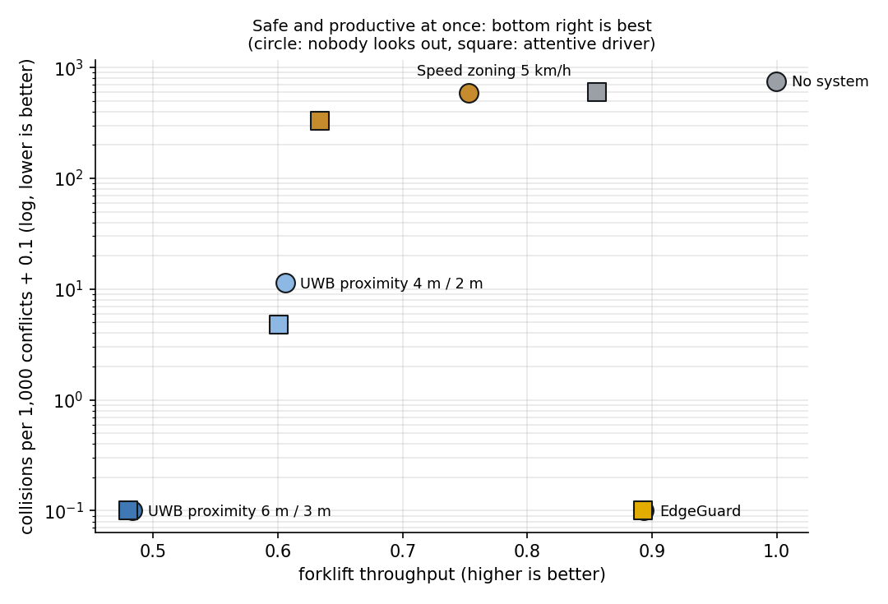

# EdgeGuard compared with what sites use today

[← README](../README.md) · [한국어](ko/site-compare.md)

How much safer, and how much more productive, is EdgeGuard than the systems warehouses use now? All systems run on the **same simulated floor, the same 300 episodes and the same sensing noise** ([`sim/site_compare.py`](../sim/site_compare.py)). The test episodes (seeds from 5000 on) were never used to train, pick or audit EdgeGuard's policy.

## The systems

| System | What it does | Basis |
|---|---|---|
| No system | Drivers and walkers rely on their own attention | — |
| Speed zoning 5 km/h | Trucks capped at the usual pedestrian-area speed in the shared aisles | Pedestrian areas and crossings are commonly limited to about 3 mph (5 km/h); OSHA asks for a speed at which the truck can stop and sets no number ([BigRentz](https://www.bigrentz.com/blog/forklift-speed-limits-osha-rules-and-best-practices-for-safe-operation), [ELOKON speed zoning](https://www.elokon.com/en-US/blog/details/automated-speed-zoning-reducing-forklift-accidents-in-real-time)) |
| UWB proximity 6 m / 3 m | Tag on the worker, anchor on the truck. Inside the warning zone the truck is slowed to walking speed (1.4 m/s) and the tag vibrates; inside the danger zone the truck stops. No notion of direction. | Warning and danger zones; slow to walking speed and stop; pedestrian alerted by vibration; detection up to 12 m ([ELOshield](https://www.elokon.com/en-US/material-handling/eloshield-vehicle-pedestrian-proximity-detection)) |
| UWB proximity 4 m / 2 m | The same, with zones narrowed to cut nuisance alarms | Sites tune zone sizes |
| EdgeGuard | Collision-course prediction on the MEC host; WAIT / GO / STEP ASIDE; one speed plan per pair; GO check; D2D fall-back | This repository |

Two crews: **nobody looks out** (what the system alone prevents) and **attentive driver** (the driver brakes for a person right in front of the truck after a 1 s reaction).

## Results (300 test episodes, 8 workers and 4 forklifts each, 1,066 conflicts)

| | Collisions (nobody looks out / attentive driver) | Forklift throughput | Worker time lost per episode | Alarms per forklift-hour (not needed) |
|---|---|---|---|---|
| No system | 804 / 638 | 100 % / 86 % | 0.1 s | 0 |
| Speed zoning 5 km/h | 633 / 350 | 75 % / 63 % | 0.1 s | 0 |
| UWB proximity 6 m / 3 m | **0** / **0** | 48 % / 48 % | 4.3 s | 1,353 (23 %) |
| UWB proximity 4 m / 2 m | 12 / 5 | 61 % / 60 % | 3.2 s | 932 (12 %) |
| **EdgeGuard (learned policy)** | **0** / **0** | **89 % / 89 %** | 2.7 s | **251 (16 %)** |

**What this says:**
- EdgeGuard is as safe as the wide proximity alarm (no collision in 1,066 conflicts, with or without an attentive driver), and keeps trucks moving at **89 % instead of 48 % of nominal (+85 %)**, with **81 % fewer alarms** and **37 % less worker waiting**.
- Against the narrowed proximity alarm, the setting sites choose to cut nuisance alarms: **0 collisions instead of 12**, **48 % more throughput** (89 % vs 61 %), 73 % fewer alarms.
- Speed zoning alone barely helps here: a walker who steps out in front of a truck at 5 km/h is still hit (594 per 1,000 conflicts), and throughput drops to 75 %.
- With an attentive driver, EdgeGuard's throughput (89 %) is above the no-system case (86 %): the alert slows a truck only as much as the conflict needs, while a startled driver brakes hard.

## How the policy was learned ([`sim/train_multi.py`](../sim/train_multi.py))

The alert and speed policy (when to warn, how fast to pass a waiting worker, the stopping envelope near a person, how long an alert holds, when GO is safe) was trained on this floor with the Cross-Entropy Method:
1. **Audit first** ([`sim/collision_audit.py`](../sim/collision_audit.py)): the remaining collisions came from the GO check using a wrong walking direction (the slow-down into a stop, a sidestep, or nothing at all). Fixed in code: the direction is learned only while the worker clearly walks, smoothed, and never from a STEP ASIDE.
2. **Stopping envelope** (`env_cap`): a person close to a truck's path ahead limits the truck to the speed at which it can still stop short of him (reaction + braking distance), quietly, without buzzing the worker.
3. **Training**: two CEM rounds, 13-15 parameters, seeds 10,000+ and 20,000+, half of the episodes with workers who ignore 15 % of alerts. Score = throughput - worker time lost - heavy penalties for collisions and close passes (< 1.5 m).
4. **Selection** on separate validation seeds (3,000+): the candidate with no collision and the highest throughput.
5. **Test** on seeds 5,000+ (this page).

| Same 300 test episodes | Collisions | Throughput | Worker time lost |
|---|---|---|---|
| Policy before learning | 1 | 86.6 % | 2.80 s |
| **Learned policy** | **0** | **89.4 %** | **2.71 s** |

A third refinement round ([`sim/train_multi_refine.py`](../sim/train_multi_refine.py), also tuning STEP ASIDE) found a candidate with 1.6 points more throughput and 18 % fewer alarms, but it had **4 collisions** on 400 fresh validation episodes where the learned policy had none. It was rejected: safety is checked on unseen episodes before throughput counts.

## Limits

- Simulation. Walkers and drivers follow simple models: nobody looks out except where stated, and a buzzed worker stops for about 2 s (proximity) or waits until GO (EdgeGuard tag).
- Proximity parameters are typical settings. Products differ, and sites tune zones, speeds and acknowledgement rules.
- Collision counts this small (0–12) have wide uncertainty: 0 vs 0 says both are rare, not equal; 0 vs 12 and the throughput gaps are significant.
- "Not needed" counts alarms for pairs that would not have come within 4 m of each other anyway.

Reproduce: `python -m sim.site_compare --episodes 300 --offset 5000` (about 15 minutes on 2 cores; `--charts-only` redraws from `results/site_compare.json`). The first comparison, before learning, is in `results/site_compare_v1_seeds200.json`.
