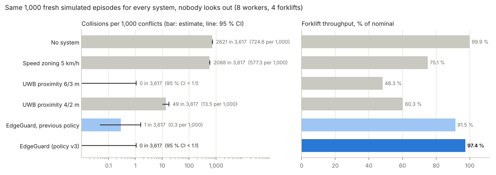

# EdgeGuard compared with what sites use today

[← README](../README.md) · [한국어](ko/site-compare.md)

How much safer, and how much more productive, is EdgeGuard than the systems warehouses use now? All systems run on the **same simulated floor, the same 300 episodes and the same sensing noise** ([`sim/site_compare.py`](../sim/site_compare.py)). The test episodes (seeds from 5000 on) were never used to train or pick EdgeGuard's policy. Under exceptional conditions (bad network, MEC restart, low compliance, ...) see [robustness.md](robustness.md).

## The systems

| System | What it does | Basis |
|---|---|---|
| No system | Drivers and walkers rely on their own attention | — |
| Speed zoning 5 km/h | Trucks capped at the usual pedestrian-area speed in the shared aisles | Pedestrian areas and crossings are commonly limited to about 3 mph (5 km/h); OSHA asks for a speed at which the truck can stop and sets no number ([BigRentz](https://www.bigrentz.com/blog/forklift-speed-limits-osha-rules-and-best-practices-for-safe-operation), [ELOKON speed zoning](https://www.elokon.com/en-US/blog/details/automated-speed-zoning-reducing-forklift-accidents-in-real-time)) |
| UWB proximity 6 m / 3 m | Tag on the worker, anchor on the truck. Inside the warning zone the truck is slowed to walking speed (1.4 m/s) and the tag vibrates; inside the danger zone the truck stops. No notion of direction. | Warning and danger zones; slow to walking speed and stop; pedestrian alerted by vibration; detection up to 12 m ([ELOshield](https://www.elokon.com/en-US/material-handling/eloshield-vehicle-pedestrian-proximity-detection)) |
| UWB proximity 4 m / 2 m | The same, with zones narrowed to cut nuisance alarms | Sites tune zone sizes |
| EdgeGuard | Collision-course prediction on the MEC host; the worker yields (WAIT / GO / STEP ASIDE) and the truck keeps its speed inside its stopping envelope, braking for stop points on its own; GO check; D2D fall-back and emergency brake | This repository |

Two crews: **nobody looks out** (what the system alone prevents) and **attentive driver** (the driver brakes for a person right in front of the truck after a 1 s reaction).

## Results (300 test episodes, 8 workers and 4 forklifts each, 1,066 conflicts)

| | Collisions (nobody looks out / attentive driver) | Forklift throughput | Worker time lost per episode | Alarms per forklift-hour (not needed) |
|---|---|---|---|---|
| No system | 804 / 638 | 100 % / 86 % | 0.1 s | 0 |
| Speed zoning 5 km/h | 633 / 350 | 75 % / 63 % | 0.1 s | 0 |
| UWB proximity 6 m / 3 m | **0** / **0** | 48 % / 48 % | 4.3 s | 1,353 (23 %) |
| UWB proximity 4 m / 2 m | 12 / 5 | 61 % / 60 % | 3.2 s | 932 (12 %) |
| EdgeGuard, previous policy | 0 / 0 | 92 % / 91 % | 2.4 s | 235 (17 %) |
| **EdgeGuard (robust policy v2)** | **0** / **0** | **97 % / 96 %** | **2.1 s** | **256 (17 %)** |

**What this says:**
- EdgeGuard is as safe as the wide proximity alarm (no collision in 1,066 conflicts, with or without an attentive driver) and keeps trucks moving at **97 % instead of 48 % of nominal (2.0 x)**, with **81 % fewer alarms** and **51 % less worker waiting**.
- Against the narrowed proximity alarm, the setting sites choose to cut nuisance alarms: **0 collisions instead of 12**, **61 % more throughput** (97 % vs 61 %), 73 % fewer alarms.
- Speed zoning alone barely helps here: a walker who steps out in front of a truck at 5 km/h is still hit (594 per 1,000 conflicts), and throughput drops to 75 %.
- With an attentive driver, EdgeGuard's throughput (96 %) is above the no-system case (86 %): the alert slows a truck only as much as the conflict needs, while a startled driver brakes hard.

## Large-scale test: 1,000 fresh episodes, with confidence intervals

The table above has 300 episodes; collision counts of 0-12 there have wide uncertainty. [`sim/large_eval.py`](../sim/large_eval.py) repeats the comparison on **1,000 fresh episodes** (seeds 21,000+, 3,617 conflicts), the same for every system, with Wilson 95 % intervals for collisions and bootstrap 95 % intervals for throughput. EdgeGuard runs the adopted policy v3.1.

| Nobody looks out | Collisions in 3,617 conflicts | per 1,000 (95 % CI) | Throughput (95 % CI) | Worker time lost | Alarms per episode |
|---|---|---|---|---|---|
| No system | 2,621 | 725 [710-739] | 99.9 % | 0.1 s | 0 |
| Speed zoning 5 km/h | 2,088 | 577 [561-593] | 75.1 % [74.6-75.6] | 0.1 s | 0 |
| UWB proximity 6 m / 3 m | 0 | 0 [0-1.06] | 48.3 % [47.3-49.3] | 4.3 s | 37.6 |
| UWB proximity 4 m / 2 m | 49 | 13.5 [10.3-17.9] | 60.3 % [59.2-61.4] | 3.3 s | 25.7 |
| EdgeGuard, previous policy | 1 | 0.28 [0.05-1.56] | 91.5 % [90.9-92.1] | 2.3 s | 6.3 |
| **EdgeGuard (policy v3.1)** | **0** | **0 [0-1.06]** | **97.3 % [96.9-97.7]** | **2.1 s** | **7.0** |

With an attentive driver: EdgeGuard 0 collisions, 96.0 % [95.5-96.4]; proximity 6/3 m 0, 47.9 %; proximity 4/2 m 20, 59.9 %.

- **As safe as the wide proximity alarm** (0 in 3,617 conflicts for both; with 1,000 episodes the upper bound is now about 1 per 1,000 conflicts) at **2.0 x its throughput** (97.3 % vs 48.3 %, intervals far apart), with **81 % fewer alarms** and **51 % less worker waiting**.
- **Against the narrowed alarm sites choose to cut nuisance alarms: 0 collisions instead of 49** (its interval starts at 10 per 1,000) and **+37 points of throughput**.
- v3.1 and v2 give the same result here (0 collisions, 97.3 % / 97.4 %, within the interval); the v3 / v3.1 changes matter under exceptional conditions ([robustness.md](robustness.md#large-scale-test-8000-fresh-episodes-per-policy-with-confidence-intervals)).

Reproduce: `python -m sim.large_eval site --episodes 1000 --offset 21000`, then `python -m sim.large_eval report` (raw data [`results/large_eval.json`](../results/large_eval.json)).

## How the policy was learned ([`sim/train_multi.py`](../sim/train_multi.py))

The alert and speed policy (when to warn, how fast to pass a waiting worker, the stopping envelope near a person, how long an alert holds, when GO is safe) was trained on this floor with the Cross-Entropy Method:
1. **Audit first** ([`sim/collision_audit.py`](../sim/collision_audit.py)): the remaining collisions came from the GO check using a wrong walking direction (the slow-down into a stop, a sidestep, or nothing at all). Fixed in code: the direction is learned only while the worker clearly walks, smoothed, and never from a STEP ASIDE.
2. **Stopping envelope** (`env_cap`): a person close to a truck's path ahead limits the truck to the speed at which it can still stop short of him (reaction + braking distance), quietly, without buzzing the worker.
3. **Training**: two CEM rounds, 13-15 parameters, seeds 10,000+ and 20,000+, half of the episodes with workers who ignore 15 % of alerts. Score = throughput - worker time lost - heavy penalties for collisions and close passes (< 1.5 m).
4. **Selection** on separate validation seeds (3,000+): the candidate with no collision and the highest throughput.
5. **Test** on seeds 5,000+ (this page).

| Same 300 test episodes | Collisions | Throughput | Worker time lost |
|---|---|---|---|
| Policy before learning | 1 | 86.6 % | 2.80 s |
| **Learned policy** | **0** | **89.4 %** | **2.71 s** |

A third refinement round ([`sim/train_multi_refine.py`](../sim/train_multi_refine.py), also tuning STEP ASIDE) found a candidate with 1.6 points more throughput and 18 % fewer alarms, but it had **4 collisions** on 400 fresh validation episodes where the learned policy had none. It was rejected: safety is checked on unseen episodes before throughput counts.

## Truck priority, stop points, robust training

Where trucks still lost time ([`sim/efficiency_audit.py`](../sim/efficiency_audit.py)): passing a waiting worker at walking pace, holding while a worker stepped aside, limits that outlived the conflict by the refresh and the clear hold, and speeding up again. Changed:
- **The worker yields, the truck keeps its speed** as long as it can still stop short of where the worker is, or where he would step in (`truck_priority`, stopping envelope `env_v2`).
- **Stop points** ("movement authority", as the limit of movement authority in ETCS): for a person in its path the truck gets the position to stop short of, and its module brakes for it from its own position every cycle, so radio latency and a lost refresh do not delay braking ([`edgeguard/device_policy.py`](../edgeguard/device_policy.py), [`firmware/common/device_policy.h`](../firmware/common/device_policy.h), compared in tests).
- Limits are eased at once when the worker has stopped (`prompt_ease`).
- Trained and picked under normal **and** exceptional conditions, with an always-on D2D emergency brake as the last line ([robustness.md](robustness.md)).

| Same 300 test episodes (same devices) | Collisions | Throughput | Worker time lost |
|---|---|---|---|
| Previous policy | 0 | 91.8 % | 2.38 s |
| Robust policy v1 | 0 | 96.8 % | 2.10 s |
| **Robust policy v2 (glide)** | **0** | **97.3 %** | **2.12 s** |

**v2 (glide)**: where trucks still lost time was speeding up again after braking into a stop point. When the worker in the path is stepping aside, the truck now rolls at the speed that reaches the stop point just as he is out, and the stop point is lifted the moment he has left the path. Refined by robust training, picked with no collision on 2,000 validation episodes.

Throughput +6.0 % over the previous policy on the same simulation (+8.8 % over the 89.4 % published before truck priority, measured without the devices' D2D layer). What is left is mostly the initial and post-stop acceleration (1 m/s²) and workers standing in a lane; removing it would take later warnings, which costs safety.

## Limits

- Simulation. Walkers and drivers follow simple models: nobody looks out except where stated, and a buzzed worker stops for about 2 s (proximity) or waits until GO (EdgeGuard tag).
- Proximity parameters are typical settings. Products differ, and sites tune zones, speeds and acknowledgement rules.
- Collision counts this small (0–12) have wide uncertainty: 0 vs 0 or 0 vs 1 says both are rare, not equal; 0 vs 12 and the throughput gaps are significant.
- "Not needed" counts alarms for pairs that would not have come within 4 m of each other anyway.

Reproduce: `python -m sim.site_compare --episodes 300 --offset 5000` (about 15 minutes on 2 cores; `--charts-only` redraws from `results/site_compare.json`). The first comparison, before learning, is in `results/site_compare_v1_seeds200.json`.
