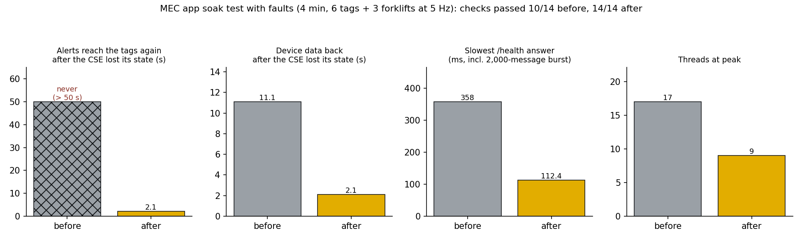

# MEC app stability: soak test with faults

[← README](../README.md) · [한국어](ko/stability.md)

[`tools/soak_test.py`](../tools/soak_test.py) runs the MEC app as its own process against an ACME IN-CSE for minutes. Six worker tags and three forklift modules publish at 5 Hz through the CSE, each under its own AE; the forklifts drive up and down three lanes and the workers keep crossing them, so alerts flow all the time. A listener in the place of the devices receives the alerts end to end (device sample → CSE → MEC app → CSE → device). The MEC app and the devices reach the CSE through a local proxy, so the link can be cut.

Faults, one after another:

| Fault | What happens |
|---|---|
| burst | 2,000 notifications straight at `/notify` from 8 threads, a third malformed (not JSON, NaN, wrong types, 200 kB strings) |
| churn | a camera reports three people at new places every frame for 30 s: hundreds of untagged tracks to forget again |
| outage | the link to the CSE is cut for 10 s |
| state loss | every AE, container and subscription on the CSE is deleted, as after a restore without its database; devices notice (404) and register again |
| WAN | the cloud copy points at an unreachable address the whole time |

## What the test found, and the fixes ([`mec_app/app.py`](../mec_app/app.py))

| Problem found | Fix |
|---|---|
| **After the CSE lost its state, alerts never reached a tag again.** The MEC app's own AE and its alert / control / risk containers were gone and it only logged 404s, so there was also no heartbeat and every forklift crawled. | Self-healing tree: a write that finds its container gone rebuilds the AE and containers and retries. A recovery mode then re-subscribes every 3 s for 2 minutes, because devices register again one by one. |
| Device data came back only when the 60 s subscription check happened to run (11 s in this run, up to 60 s). | Recovery mode starts when the CSE answers again after failed writes, when the tree had to be rebuilt, or when no device has been heard for 8 s although devices were live. |
| A background loop that raised stopped for good: the heartbeat, publisher, zone broadcast or MEC-IPE watch disappeared silently. | Every loop runs under a supervisor that logs the traceback and restarts it; `/health` lists each loop with restarts and the age of its last tick, and reports `degraded` if one stalls. |
| A notification burst tied up the web server's thread pool with risk evaluations: `/health` slowed to 358 ms here, and to over 5 s in an earlier run. | `/notify` answers at once and queues; one worker runs the risk engine. A device's newer waiting sample replaces its older one, so the delay stays bounded and the CSE never sees a slow notification. |
| Camera `untagged_N` ids left WAIT cues, STEP ASIDE timers and zone timers behind for ever. | Garbage collection drops side tables of forgotten tracks; `/health` shows every table size. |

Two client fixes found on the way ([`edgeguard/onem2m.py`](../edgeguard/onem2m.py)): ACME answers "originator has already registered" (4117) for an AE that exists, which now counts as existing; and creating a subscription that another client is creating at the same moment is retried.

## Results (4 minutes, same harness for both)

| | Before | After |
|---|---|---|
| Checks passed | 10 / 14 | **14 / 14** |
| Alerts reach the tags again after the CSE lost its state | **never** (not within the remaining 50 s) | **2.1 s** |
| Device data back after the CSE lost its state | 11.1 s | **2.1 s** |
| Device data and alerts back after a 10 s outage | 1.4 s | 1.3 s |
| Slowest `/health` answer (incl. the burst) | 358 ms | **112 ms** |
| Threads at peak | 17 | 9 |
| Memory growth after warm-up | 3.4 MB | 2.4 MB |
| Alert latency end to end, normal operation (p50 / p95) | 87 / 134 ms | 94 / 139 ms |
| Background loops and table sizes visible in `/health` | no | yes |

CI runs the soak test on every commit (3.5 minutes).

## ACME behaviour seen under these faults

Three things in ACME 2026.05.3 made faults worse. They are written up for the ACME project in [forum/acme-issues.md](forum/acme-issues.md):
- A request that reaches ACME while it is still starting aborts the start ("add_url_rule can no longer be called"). With devices sending all the time, a restarted CSE does not come up.
- Deleting an AE while its subscription's notification target is unreachable can leave the subscription behind: creating it again answers 409 "already exists", updating it answers 404.
- Creating and deleting the same AE at the same moment can leave an originator registered without an AE: every later registration answers 4117.
