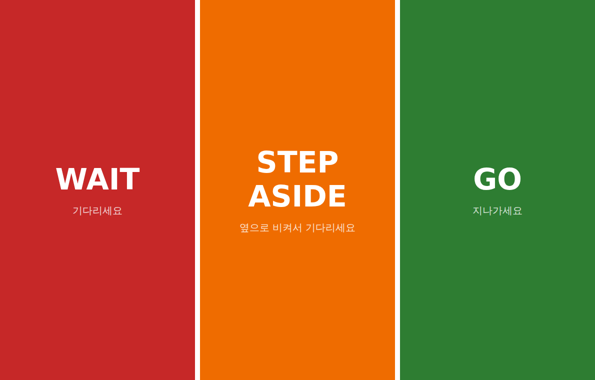

# User study (worker cues · site feedback)

[← README](../README.md) · [한국어](ko/user-study.md)

The simulation's biggest assumption is **how people respond to cues** (stop within 0.8 s of the vibration, wait until GO, step aside on STEP ASIDE).
This kit measures that on real people, and the measured values are fed back into the simulation. No forklift is used, so it can be run safely even in a university hallway.



## 1. Cue response experiment (10+ participants, about 8 min each)

**Hypotheses**

| | Hypothesis | Criterion |
|---|---|---|
| H1 | WAIT/GO yields a lower rate of "walking again before the forklift has passed" than a single vibration (BUZZ) | Compare premature start rate by condition |
| H2 | Participants understand the cues without explanation | ≥ 80 % correct on survey comprehension items |
| H3 | Participants step aside correctly on STEP ASIDE | ≥ 80 % step-aside accuracy |

**Setup**: 1 laptop (observer), a participant phone (Android Chrome recommended; iPhone uses sound and screen instead of vibration), a hallway of about 10 m, same Wi-Fi.

```bash
python tools/user_study.py            # Observer: http://<laptop IP>:9300/observer
                                      # Participant phone: http://<laptop IP>:9300/tag  ("Start" button enables vibration)
                                      # Survey:      http://<laptop IP>:9300/survey
```

**Procedure**

1. Obtain consent (record only anonymous IDs `P01`, `P02`, …) and tell the participant only this: "Hold the phone and walk slowly up and down the hallway. When the screen and vibration change, act accordingly."
2. Enter the ID on the observer screen and press **Start session**. The condition order (BUZZ ↔ WAITGO) alternates automatically by ID (counterbalancing order effects).
3. While the participant walks, press **Next trial** and a cue is sent at a random time 2–6 s later. 5 trials per condition
   (BUZZ: one vibration / WAITGO: 3 × WAIT + 2 × STEP ASIDE, with GO sent automatically 4 s after the cue).
4. The observer logs the participant's actual behaviour as it happens: **Stopped · Walked again · Stepped aside**.
5. At the end, the participant submits the **survey** on the phone (3 cue comprehension items + 5 five-point scale items + free comments).

**Analysis**

```bash
python tools/study_report.py          # Per condition: stop reaction time · premature start rate · GO response · step-aside accuracy · comprehension · scale means
                                      # → results/user_study_summary.json
python -m sim.failsafe_eval --modes coop --ux hold --comply <measured WAIT compliance rate>   # re-evaluate with the measured compliance rate
```

Premature start = starting to walk before GO under WAIT · STEP ASIDE / starting to walk again within 4 s of the cue under BUZZ (the time a virtual forklift takes to pass).
The measured WAIT compliance rate (1 − premature start rate) is the simulation's `Mover.COMPLY`. Current results are presented as a sensitivity sweep over 50–100 % compliance,
so where the measured value falls in that range is the expected benefit (85 % → 12 / 1,207 collisions, 50 % → 42 / 1,207; v1.0 had 145).

## 2. Site feedback (interviews with safety managers · logistics centre workers, 3+ people, 20 min)

| # | Question |
|---|---|
| 1 | In what situations do forklift–pedestrian accidents and near misses mostly happen? (intersections, aisles, reversing, blind spots) |
| 2 | What is inconvenient about the safety devices you use now (beacons, proximity alerts, blue lights, etc.)? Have you ever switched them off or ignored them because alerts went off too often? |
| 3 | Which would be easier to follow: a "WAIT → GO" cue or a single vibration? Why? |
| 4 | Is a "STEP ASIDE" cue feasible in your site's traffic flow? Where would it be impossible? |
| 5 | As a driver, would you object to the forklift slowing down automatically? How much slowdown would you accept? |
| 6 | What would it take for workers to wear the tag all the time? (weight, charging, wearing position) |
| 7 | How would you use the near-miss heatmap and improvement report? (training, layout changes, reporting) |
| 8 | What matters most for an adoption decision? (cost, installation time, productivity, legal compliance) What monthly cost per person / per forklift is acceptable? |
| 9 | How should the system behave during a network outage or server failure for you to feel safe? |
| 10 | Would you take part in a pilot? Under what conditions? |

Summarise answers per person (anonymised) in `results/field_interviews.md`, and replace the assumptions in [Cost and business model](business.md) (monthly subscription, number of encounters) with the actual answers.

## 3. Results log

| Date | Type | Participants | Key result | File |
|---|---|---|---|---|
| (not yet run) | Cue response experiment | | | `results/user_study_summary.json` |
| (not yet run) | Site interviews | | | `results/field_interviews.md` |

The kit has been verified to work (automated test `tests/test_user_study.py`, end-to-end with virtual participants through the server, phone screen and analysis). The experiment with real participants still has to be run by the team.
